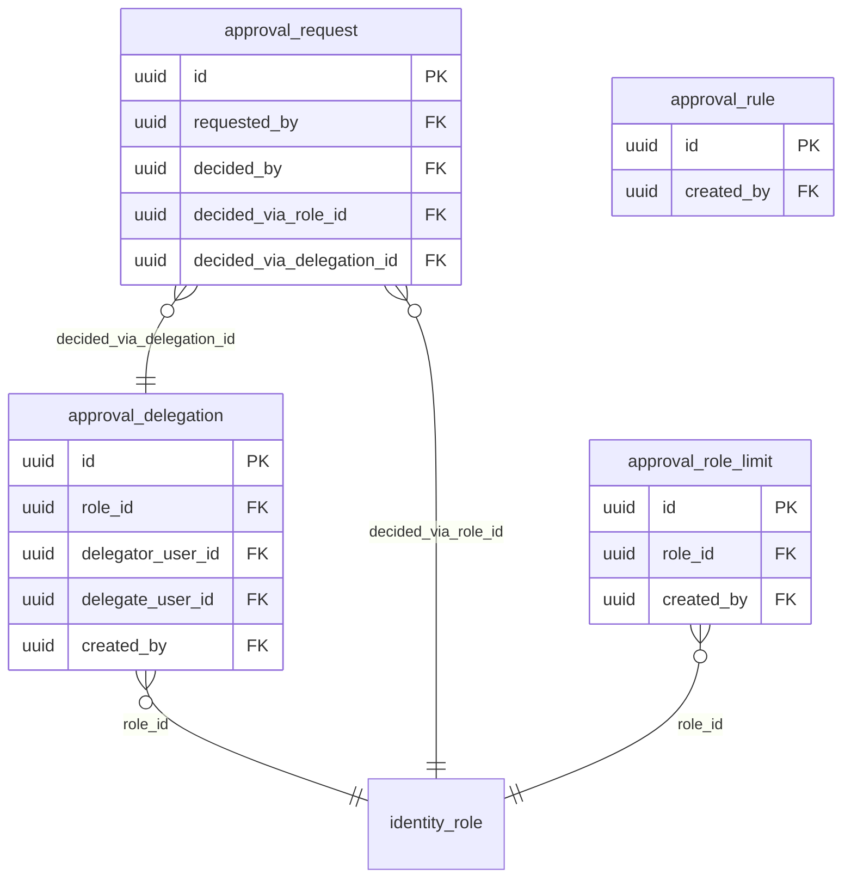
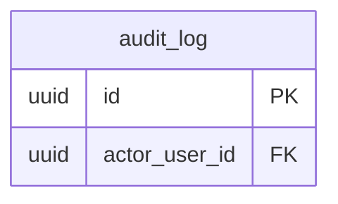
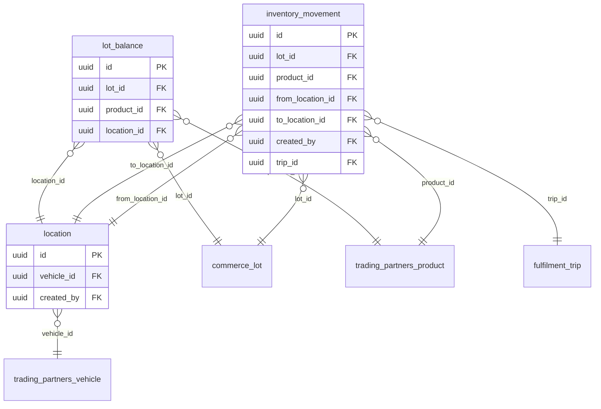
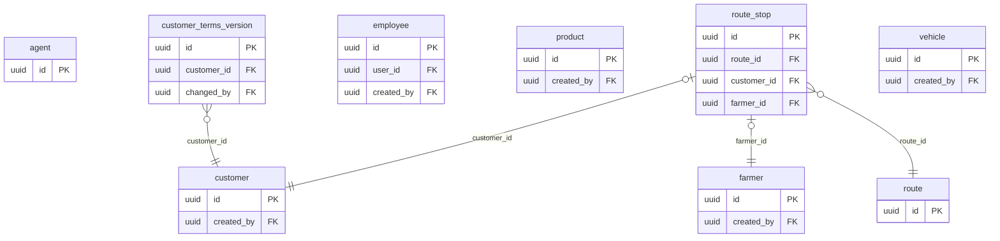

# Database — ERD, keys and indexes

Generated by `database/scripts/schema-report.js` from the live catalog (2026-11-10). Do not edit by hand — rerun it after a migration.

**138 tables** in 16 schemas, **476 foreign keys**, 424 indexes. Every table without row-level security is listed in the review below.

Conventions (System Architecture, Production Database): UUID primary keys; `tenant_id` on every business table, enforced by RLS (ENABLE + FORCE) with a tenant-isolation policy; money `numeric(…,2)`, quantities `numeric(…,3)` (exact — Master Spec v3 decision D5); history and events insert-only; deletes `RESTRICT`.

## Review

### Tenant tables without forced row-level security (0)

- None.


Global by design (no tenant): `identity.permission`, `money.ledger_account`, `tenant.tenant`.

### Business foreign keys with no index leading on them (3)

Leading on the key, or on `tenant_id` then the key (every app query carries `tenant_id` under RLS). Lookups from the parent scan the child without one.

- `money.agent_commission(purchase_order_id)` → `commerce.purchase_order`
- `money.credit_note(customer_id)` → `trading_partners.customer`
- `money.credit_note_line(invoice_line_id)` → `money.invoice_line`


Not indexed on purpose: 142 audit links (who did it → `identity.app_user`; the journal it made → `money.ledger_entry`), never searched from the parent.

### Many-to-many (junction) tables (3)

- `chat.read_marker` joins `trading_partners.employee` and `identity.app_user`
- `identity.role_permission` joins `identity.permission` and `identity.role`
- `identity.user_role` joins `identity.role` and `identity.app_user`

## Schema `ai` (6 tables)

```mermaid
erDiagram
  ai_settings {
    uuid tenant_id PK FK
    uuid updated_by FK
  }
  inbound_message {
    uuid id PK
    uuid customer_id FK
    uuid recommendation_id FK
  }
  recommendation {
    uuid id PK
    uuid run_id FK
  }
  recommendation_decision {
    uuid recommendation_id PK FK
    uuid decided_by FK
  }
  run {
    uuid id PK
    uuid created_by FK
  }
  voice_call {
    uuid id PK
    uuid customer_id FK
    uuid order_id FK
    uuid requested_by FK
  }
  inbound_message }o--|| trading_partners_customer : "customer_id"
  inbound_message }o--|| recommendation : "recommendation_id"
  recommendation }o--|| run : "run_id"
  recommendation_decision |o--|| recommendation : "recommendation_id"
  voice_call }o--|| trading_partners_customer : "customer_id"
  voice_call }o--|| commerce_customer_order : "order_id"
```

### `ai.ai_settings`

- **Primary key:** tenant_id
- **References:** tenant_id → `tenant.tenant` (one-to-one, on delete restrict); updated_by → `identity.app_user` (many-to-one, on delete restrict)
- **Row-level security:** forced — ai_settings_tenant_isolation (all)
- **Columns:** tenant_id uuid not null, target_margin_pct numeric not null, max_price_move_pct numeric not null, min_customer_margin_pct numeric not null, cost_of_capital_pct numeric not null, default_cost_per_km numeric not null, disabled_types ARRAY not null, version integer not null, updated_by uuid, updated_at timestamp with time zone not null

### `ai.inbound_message`

- **Primary key:** id
- **References:** customer_id → `trading_partners.customer` (many-to-one, on delete restrict); recommendation_id → `ai.recommendation` (many-to-one, on delete restrict); tenant_id → `tenant.tenant` (many-to-one, on delete restrict)
- **Unique:** (tenant_id, channel, provider_message_id)
- **Row-level security:** forced — inbound_message_tenant_isolation (all)
- **Indexes:** unique (tenant_id, channel, provider_message_id); (tenant_id, customer_id); (tenant_id, received_at); (tenant_id, recommendation_id)
- **Columns:** id uuid not null, tenant_id uuid not null, channel text not null, provider_message_id text not null, from_phone text not null, sender_name text, customer_id uuid, message_type text not null, body text not null, received_at timestamp with time zone not null, status text not null, reader text, extraction jsonb, recommendation_id uuid, note text, replied_at timestamp with time zone, created_at timestamp with time zone not null

### `ai.recommendation`

- **Primary key:** id
- **References:** run_id → `ai.run` (many-to-one, on delete restrict); tenant_id → `tenant.tenant` (many-to-one, on delete restrict)
- **Row-level security:** forced — recommendation_tenant_isolation (all)
- **Indexes:** (subject_kind, subject_id); (tenant_id, run_id); (tenant_id, type, created_at)
- **Columns:** id uuid not null, tenant_id uuid not null, run_id uuid not null, type text not null, subject_kind text not null, subject_id uuid, target_date date, title text not null, proposal jsonb not null, evidence jsonb not null, explanation text not null, expected_impact numeric, confidence text not null, sensitive boolean not null, producer text not null, expires_at timestamp with time zone not null, created_at timestamp with time zone not null

### `ai.recommendation_decision`

- **Primary key:** recommendation_id
- **References:** decided_by → `identity.app_user` (many-to-one, on delete restrict); recommendation_id → `ai.recommendation` (one-to-one, on delete restrict); tenant_id → `tenant.tenant` (many-to-one, on delete restrict)
- **Row-level security:** forced — recommendation_decision_tenant_isolation (all)
- **Columns:** recommendation_id uuid not null, tenant_id uuid not null, decision text not null, decided_by uuid, decided_at timestamp with time zone not null, submitted jsonb, reason text, result_ref jsonb

### `ai.run`

- **Primary key:** id
- **References:** created_by → `identity.app_user` (many-to-one, on delete restrict); tenant_id → `tenant.tenant` (many-to-one, on delete restrict)
- **Row-level security:** forced — run_tenant_isolation (all)
- **Indexes:** (tenant_id, started_at)
- **Columns:** id uuid not null, tenant_id uuid not null, started_at timestamp with time zone not null, finished_at timestamp with time zone not null, produced jsonb not null, suppressed jsonb not null, created_by uuid, source text not null

### `ai.voice_call`

- **Primary key:** id
- **References:** customer_id → `trading_partners.customer` (many-to-one, on delete restrict); order_id → `commerce.customer_order` (many-to-one, on delete restrict); requested_by → `identity.app_user` (many-to-one, on delete restrict); tenant_id → `tenant.tenant` (many-to-one, on delete restrict)
- **Unique:** (provider_attempt_id)
- **Row-level security:** forced — voice_call_definer_lookup (select), voice_call_tenant_isolation (all)
- **Indexes:** unique (provider_attempt_id); (tenant_id, created_at); (tenant_id, customer_id, created_at); (tenant_id, order_id)
- **Columns:** id uuid not null, tenant_id uuid not null, customer_id uuid not null, purpose text not null, language text not null, to_phone text not null, brief jsonb not null, order_id uuid, provider_attempt_id text, status text not null, outcome text, ended_at timestamp with time zone, duration_seconds integer, error text, requested_by uuid not null, created_at timestamp with time zone not null, updated_at timestamp with time zone not null, topic text, interaction_id text, summary text, details jsonb, transcript jsonb, webhook_token text not null

## Schema `approvals` (4 tables)



### `approvals.approval_delegation`

- **Primary key:** id
- **References:** created_by → `identity.app_user` (many-to-one, on delete restrict); delegate_user_id → `identity.app_user` (many-to-one, on delete restrict); delegator_user_id → `identity.app_user` (many-to-one, on delete restrict); role_id → `identity.role` (many-to-one, on delete cascade); tenant_id → `tenant.tenant` (many-to-one, on delete restrict)
- **Row-level security:** forced — approval_delegation_tenant_isolation (all)
- **Indexes:** (tenant_id, delegate_user_id, role_id); (tenant_id, role_id)
- **Columns:** id uuid not null, tenant_id uuid not null, role_id uuid not null, delegator_user_id uuid not null, delegate_user_id uuid not null, starts_at timestamp with time zone not null, ends_at timestamp with time zone not null, revoked_at timestamp with time zone, created_at timestamp with time zone not null, created_by uuid not null

### `approvals.approval_request`

- **Primary key:** id
- **References:** decided_by → `identity.app_user` (many-to-one, on delete restrict); decided_via_role_id → `identity.role` (many-to-one, on delete restrict); decided_via_delegation_id → `approvals.approval_delegation` (many-to-one, on delete restrict); requested_by → `identity.app_user` (many-to-one, on delete restrict); tenant_id → `tenant.tenant` (many-to-one, on delete restrict)
- **Row-level security:** forced — approval_request_tenant_isolation (all)
- **Indexes:** (tenant_id, action_type, subject_id); (tenant_id, decided_via_delegation_id); (tenant_id, decided_via_role_id); (tenant_id, status)
- **Columns:** id uuid not null, tenant_id uuid not null, action_type text not null, subject_id uuid not null, amount numeric, status text not null, requested_by uuid not null, decided_by uuid, decided_via_role_id uuid, decided_via_delegation_id uuid, decision_note text, decided_at timestamp with time zone, version integer not null, created_at timestamp with time zone not null, updated_at timestamp with time zone not null

### `approvals.approval_role_limit`

- **Primary key:** id
- **References:** created_by → `identity.app_user` (many-to-one, on delete restrict); role_id → `identity.role` (many-to-one, on delete cascade); tenant_id → `tenant.tenant` (many-to-one, on delete restrict)
- **Row-level security:** forced — approval_role_limit_tenant_isolation (all)
- **Indexes:** unique (tenant_id, role_id, action_type) where (action_type IS NOT NULL); unique (tenant_id, role_id) where (action_type IS NULL)
- **Columns:** id uuid not null, tenant_id uuid not null, role_id uuid not null, action_type text, max_amount numeric, created_at timestamp with time zone not null, updated_at timestamp with time zone not null, created_by uuid not null

### `approvals.approval_rule`

- **Primary key:** id
- **References:** created_by → `identity.app_user` (many-to-one, on delete restrict); tenant_id → `tenant.tenant` (many-to-one, on delete restrict)
- **Unique:** (tenant_id, action_type)
- **Row-level security:** forced — approval_rule_tenant_isolation (all)
- **Indexes:** unique (tenant_id, action_type)
- **Columns:** id uuid not null, tenant_id uuid not null, action_type text not null, threshold_amount numeric not null, is_active boolean not null, created_at timestamp with time zone not null, updated_at timestamp with time zone not null, created_by uuid not null

## Schema `chat` (2 tables)

```mermaid
erDiagram
  message {
    uuid id PK
    uuid driver_employee_id FK
    uuid sender_user_id FK
    uuid trip_id FK
  }
  read_marker {
    uuid user_id PK FK
    uuid driver_employee_id PK FK
  }
  message }o--|| trading_partners_employee : "driver_employee_id"
  message }o--|| fulfilment_trip : "trip_id"
  read_marker }o--|| trading_partners_employee : "driver_employee_id"
```

### `chat.message`

- **Primary key:** id
- **References:** driver_employee_id → `trading_partners.employee` (many-to-one, on delete restrict); sender_user_id → `identity.app_user` (many-to-one, on delete restrict); tenant_id → `tenant.tenant` (many-to-one, on delete restrict); trip_id → `fulfilment.trip` (many-to-one, on delete restrict)
- **Row-level security:** forced — message_tenant_isolation (all)
- **Indexes:** (tenant_id, driver_employee_id, created_at); (trip_id) where (trip_id IS NOT NULL)
- **Columns:** id uuid not null, tenant_id uuid not null, driver_employee_id uuid not null, sender_user_id uuid not null, side text not null, body text, trip_id uuid, photo_expected boolean not null, photo_key text, photo_content_type text, written_at timestamp with time zone not null, created_at timestamp with time zone not null

### `chat.read_marker` — junction

- **Primary key:** user_id, driver_employee_id
- **References:** driver_employee_id → `trading_partners.employee` (many-to-one, on delete restrict); tenant_id → `tenant.tenant` (many-to-one, on delete restrict); user_id → `identity.app_user` (many-to-one, on delete restrict)
- **Row-level security:** forced — read_marker_tenant_isolation (all)
- **Indexes:** (tenant_id, driver_employee_id)
- **Columns:** tenant_id uuid not null, user_id uuid not null, driver_employee_id uuid not null, read_at timestamp with time zone not null

## Schema `commerce` (8 tables)

```mermaid
erDiagram
  customer_order {
    uuid id PK
    uuid customer_id FK
    uuid approval_request_id FK
    uuid created_by FK
    uuid route_id FK
    uuid planned_driver_id FK
    uuid planned_vehicle_id FK
  }
  customer_order_line {
    uuid id PK
    uuid order_id FK
    uuid product_id FK
  }
  document_counter {
    uuid tenant_id PK FK
    text kind PK
  }
  lot {
    uuid id PK
    uuid purchase_order_id FK
    uuid farmer_id FK
    uuid product_id FK
    uuid pickup_id FK
    uuid graded_by FK
    uuid created_by FK
  }
  lot_allocation {
    uuid id PK
    uuid balance_id FK
    uuid lot_id FK
    uuid order_line_id FK
  }
  pickup {
    uuid id PK
    uuid purchase_order_id FK
    uuid farmer_id FK
    uuid vehicle_id FK
    uuid driver_employee_id FK
    uuid created_by FK
  }
  purchase_order {
    uuid id PK
    uuid farmer_id FK
    uuid approval_request_id FK
    uuid created_by FK
    uuid planned_driver_id FK
    uuid planned_vehicle_id FK
    uuid agent_id FK
  }
  purchase_order_line {
    uuid id PK
    uuid purchase_order_id FK
    uuid product_id FK
  }
  customer_order }o--|| approvals_approval_request : "approval_request_id"
  customer_order }o--|| trading_partners_customer : "customer_id"
  customer_order }o--|| trading_partners_employee : "planned_driver_id"
  customer_order }o--|| trading_partners_vehicle : "planned_vehicle_id"
  customer_order }o--|| trading_partners_route : "route_id"
  customer_order_line }o--|| customer_order : "order_id"
  customer_order_line }o--|| trading_partners_product : "product_id"
  lot }o--|| trading_partners_farmer : "farmer_id"
  lot }o--|| pickup : "pickup_id"
  lot }o--|| trading_partners_product : "product_id"
  lot }o--|| purchase_order : "purchase_order_id"
  lot_allocation }o--|| stock_lot_balance : "balance_id"
  lot_allocation }o--|| lot : "lot_id"
  lot_allocation }o--|| customer_order_line : "order_line_id"
  pickup }o--|| trading_partners_employee : "driver_employee_id"
  pickup }o--|| trading_partners_farmer : "farmer_id"
  pickup }o--|| purchase_order : "purchase_order_id"
  pickup }o--|| trading_partners_vehicle : "vehicle_id"
  purchase_order }o--|| trading_partners_agent : "agent_id"
  purchase_order }o--|| approvals_approval_request : "approval_request_id"
  purchase_order }o--|| trading_partners_farmer : "farmer_id"
  purchase_order }o--|| trading_partners_employee : "planned_driver_id"
  purchase_order }o--|| trading_partners_vehicle : "planned_vehicle_id"
  purchase_order_line }o--|| trading_partners_product : "product_id"
  purchase_order_line }o--|| purchase_order : "purchase_order_id"
```

### `commerce.customer_order`

- **Primary key:** id
- **References:** approval_request_id → `approvals.approval_request` (many-to-one, on delete restrict); created_by → `identity.app_user` (many-to-one, on delete restrict); customer_id → `trading_partners.customer` (many-to-one, on delete restrict); planned_driver_id → `trading_partners.employee` (many-to-one, on delete restrict); planned_vehicle_id → `trading_partners.vehicle` (many-to-one, on delete restrict); route_id → `trading_partners.route` (many-to-one, on delete restrict); tenant_id → `tenant.tenant` (many-to-one, on delete restrict)
- **Unique:** (tenant_id, number)
- **Row-level security:** forced — customer_order_tenant_isolation (all)
- **Indexes:** unique (tenant_id, number); (tenant_id, approval_request_id); (tenant_id, customer_id); (tenant_id, delivery_date); (tenant_id, planned_driver_id); (tenant_id, planned_vehicle_id); (tenant_id, route_id); (tenant_id, status)
- **Columns:** id uuid not null, tenant_id uuid not null, customer_id uuid not null, status text not null, approval_request_id uuid, version integer not null, created_at timestamp with time zone not null, updated_at timestamp with time zone not null, created_by uuid not null, number integer not null, delivery_date date, delivery_time time without time zone, route_id uuid, planned_driver_id uuid, planned_vehicle_id uuid, delivery_address text, credit_term_days integer, notes text

### `commerce.customer_order_line`

- **Primary key:** id
- **References:** order_id → `commerce.customer_order` (many-to-one, on delete cascade); product_id → `trading_partners.product` (many-to-one, on delete restrict); tenant_id → `tenant.tenant` (many-to-one, on delete restrict)
- **Row-level security:** forced — customer_order_line_tenant_isolation (all)
- **Indexes:** (order_id); (tenant_id, order_id); (tenant_id, product_id)
- **Columns:** id uuid not null, order_id uuid not null, product_id uuid not null, quantity numeric not null, unit_price numeric not null, created_at timestamp with time zone not null, delivered_quantity numeric, tenant_id uuid not null

### `commerce.document_counter`

- **Primary key:** tenant_id, kind
- **References:** tenant_id → `tenant.tenant` (many-to-one, on delete restrict)
- **Row-level security:** forced — document_counter_tenant_isolation (all)
- **Columns:** tenant_id uuid not null, kind text not null, last_number integer not null

### `commerce.lot`

- **Primary key:** id
- **References:** created_by → `identity.app_user` (many-to-one, on delete restrict); farmer_id → `trading_partners.farmer` (many-to-one, on delete restrict); graded_by → `identity.app_user` (many-to-one, on delete restrict); pickup_id → `commerce.pickup` (many-to-one, on delete restrict); product_id → `trading_partners.product` (many-to-one, on delete restrict); purchase_order_id → `commerce.purchase_order` (many-to-one, on delete restrict); tenant_id → `tenant.tenant` (many-to-one, on delete restrict)
- **Row-level security:** forced — lot_tenant_isolation (all)
- **Indexes:** (purchase_order_id); (tenant_id, farmer_id); (tenant_id, pickup_id); (tenant_id, product_id, graded_at); (tenant_id, status)
- **Columns:** id uuid not null, tenant_id uuid not null, purchase_order_id uuid not null, farmer_id uuid not null, product_id uuid not null, pickup_id uuid, received_quantity numeric not null, accepted_quantity numeric, rejected_quantity numeric, grade text, rejection_reason text, unit_cost numeric, status text not null, received_at timestamp with time zone not null, graded_at timestamp with time zone, graded_by uuid, version integer not null, created_at timestamp with time zone not null, updated_at timestamp with time zone not null, created_by uuid not null, current_quantity numeric

### `commerce.lot_allocation`

- **Primary key:** id
- **References:** balance_id → `stock.lot_balance` (many-to-one, on delete restrict); lot_id → `commerce.lot` (many-to-one, on delete restrict); order_line_id → `commerce.customer_order_line` (many-to-one, on delete restrict); tenant_id → `tenant.tenant` (many-to-one, on delete restrict)
- **Unique:** (balance_id, order_line_id)
- **Row-level security:** forced — lot_allocation_tenant_isolation (all)
- **Indexes:** (lot_id); unique (balance_id, order_line_id); (order_line_id)
- **Columns:** id uuid not null, tenant_id uuid not null, balance_id uuid not null, lot_id uuid not null, order_line_id uuid not null, reserved_quantity numeric not null, delivered_quantity numeric not null, created_at timestamp with time zone not null, updated_at timestamp with time zone not null

### `commerce.pickup`

- **Primary key:** id
- **References:** created_by → `identity.app_user` (many-to-one, on delete restrict); driver_employee_id → `trading_partners.employee` (many-to-one, on delete restrict); farmer_id → `trading_partners.farmer` (many-to-one, on delete restrict); purchase_order_id → `commerce.purchase_order` (many-to-one, on delete restrict); tenant_id → `tenant.tenant` (many-to-one, on delete restrict); vehicle_id → `trading_partners.vehicle` (many-to-one, on delete restrict)
- **Row-level security:** forced — pickup_tenant_isolation (all)
- **Indexes:** (purchase_order_id); (tenant_id, driver_employee_id); (tenant_id, farmer_id); (tenant_id, status); (tenant_id, vehicle_id)
- **Columns:** id uuid not null, tenant_id uuid not null, purchase_order_id uuid not null, farmer_id uuid not null, vehicle_id uuid, driver_employee_id uuid, status text not null, scheduled_at timestamp with time zone, picked_up_at timestamp with time zone, notes text, version integer not null, created_at timestamp with time zone not null, updated_at timestamp with time zone not null, created_by uuid not null

### `commerce.purchase_order`

- **Primary key:** id
- **References:** agent_id → `trading_partners.agent` (many-to-one, on delete restrict); approval_request_id → `approvals.approval_request` (many-to-one, on delete restrict); created_by → `identity.app_user` (many-to-one, on delete restrict); farmer_id → `trading_partners.farmer` (many-to-one, on delete restrict); planned_driver_id → `trading_partners.employee` (many-to-one, on delete restrict); planned_vehicle_id → `trading_partners.vehicle` (many-to-one, on delete restrict); tenant_id → `tenant.tenant` (many-to-one, on delete restrict)
- **Unique:** (tenant_id, number)
- **Row-level security:** forced — purchase_order_tenant_isolation (all)
- **Indexes:** unique (tenant_id, number); (tenant_id, agent_id); (tenant_id, approval_request_id); (tenant_id, farmer_id); (tenant_id, pickup_date); (tenant_id, planned_driver_id); (tenant_id, planned_vehicle_id); (tenant_id, status)
- **Columns:** id uuid not null, tenant_id uuid not null, farmer_id uuid not null, status text not null, expected_delivery_date date, approval_request_id uuid, version integer not null, created_at timestamp with time zone not null, updated_at timestamp with time zone not null, created_by uuid not null, number integer not null, pickup_date date, pickup_time time without time zone, planned_driver_id uuid, planned_vehicle_id uuid, agent_id uuid, commission_per_kg numeric, notes text

### `commerce.purchase_order_line`

- **Primary key:** id
- **References:** product_id → `trading_partners.product` (many-to-one, on delete restrict); purchase_order_id → `commerce.purchase_order` (many-to-one, on delete cascade); tenant_id → `tenant.tenant` (many-to-one, on delete restrict)
- **Row-level security:** forced — purchase_order_line_tenant_isolation (all)
- **Indexes:** (purchase_order_id); (tenant_id, product_id); (tenant_id, purchase_order_id)
- **Columns:** id uuid not null, purchase_order_id uuid not null, product_id uuid not null, expected_quantity numeric not null, indicative_price numeric not null, created_at timestamp with time zone not null, bags numeric, kg_per_bag numeric, tenant_id uuid not null

## Schema `crates` (6 tables)

```mermaid
erDiagram
  crate_limit {
    text holder_kind PK
    uuid holder_id PK
    uuid updated_by FK
  }
  crate_loss {
    uuid id PK
    uuid movement_id FK
    uuid invoice_id FK
    uuid ledger_entry_id FK
    uuid created_by FK
  }
  crate_settings {
    uuid tenant_id PK FK
    uuid updated_by FK
  }
  crate_type {
    uuid id PK
    uuid created_by FK
  }
  movement {
    uuid id PK
    uuid crate_type_id FK
    uuid trip_id FK
    uuid trip_stop_id FK
    uuid reverses_movement_id FK
    uuid created_by FK
  }
  payable_deduction {
    uuid id PK
    uuid loss_id FK
    uuid payable_id FK
  }
  crate_loss }o--|| money_invoice : "invoice_id"
  crate_loss }o--|| money_ledger_entry : "ledger_entry_id"
  crate_loss |o--|| movement : "movement_id"
  movement }o--|| crate_type : "crate_type_id"
  movement }o--|| movement : "reverses_movement_id"
  movement }o--|| fulfilment_trip : "trip_id"
  movement }o--|| fulfilment_trip_stop : "trip_stop_id"
  payable_deduction }o--|| crate_loss : "loss_id"
  payable_deduction }o--|| money_farmer_payable : "payable_id"
```

### `crates.crate_limit`

- **Primary key:** holder_kind, holder_id
- **References:** tenant_id → `tenant.tenant` (many-to-one, on delete restrict); updated_by → `identity.app_user` (many-to-one, on delete restrict)
- **Row-level security:** forced — crate_limit_tenant_isolation (all)
- **Columns:** tenant_id uuid not null, holder_kind text not null, holder_id uuid not null, max_crates integer not null, updated_by uuid, updated_at timestamp with time zone not null

### `crates.crate_loss`

- **Primary key:** id
- **References:** created_by → `identity.app_user` (many-to-one, on delete restrict); invoice_id → `money.invoice` (many-to-one, on delete restrict); ledger_entry_id → `money.ledger_entry` (many-to-one, on delete restrict); movement_id → `crates.movement` (one-to-one, on delete restrict); tenant_id → `tenant.tenant` (many-to-one, on delete restrict)
- **Unique:** (movement_id)
- **Row-level security:** forced — crate_loss_tenant_isolation (all)
- **Indexes:** unique (movement_id); (tenant_id, invoice_id)
- **Columns:** id uuid not null, tenant_id uuid not null, movement_id uuid not null, recovery text not null, unit_charge numeric not null, amount numeric not null, tax_amount numeric not null, invoice_id uuid, ledger_entry_id uuid, reason text not null, created_by uuid not null, created_at timestamp with time zone not null

### `crates.crate_settings`

- **Primary key:** tenant_id
- **References:** tenant_id → `tenant.tenant` (one-to-one, on delete restrict); updated_by → `identity.app_user` (many-to-one, on delete restrict)
- **Row-level security:** forced — crate_settings_tenant_isolation (all)
- **Columns:** tenant_id uuid not null, customer_overdue_days integer not null, farmer_overdue_days integer not null, version integer not null, updated_by uuid, updated_at timestamp with time zone not null

### `crates.crate_type`

- **Primary key:** id
- **References:** created_by → `identity.app_user` (many-to-one, on delete restrict); tenant_id → `tenant.tenant` (many-to-one, on delete restrict)
- **Unique:** (tenant_id, code)
- **Row-level security:** forced — crate_type_tenant_isolation (all)
- **Indexes:** unique (tenant_id, code)
- **Columns:** id uuid not null, tenant_id uuid not null, code text not null, name text not null, capacity_kg numeric, replacement_cost numeric not null, hsn_code text, reorder_level integer not null, is_active boolean not null, version integer not null, created_by uuid not null, created_at timestamp with time zone not null, updated_at timestamp with time zone not null

### `crates.movement`

- **Primary key:** id
- **References:** crate_type_id → `crates.crate_type` (many-to-one, on delete restrict); created_by → `identity.app_user` (many-to-one, on delete restrict); reverses_movement_id → `crates.movement` (many-to-one, on delete restrict); tenant_id → `tenant.tenant` (many-to-one, on delete restrict); trip_id → `fulfilment.trip` (many-to-one, on delete restrict); trip_stop_id → `fulfilment.trip_stop` (many-to-one, on delete restrict)
- **Row-level security:** forced — movement_tenant_isolation (all)
- **Indexes:** (batch_id); (from_kind, from_id); unique (reverses_movement_id) where (reverses_movement_id IS NOT NULL); (tenant_id, crate_type_id); (tenant_id, occurred_at); (tenant_id, trip_stop_id); (to_kind, to_id); (trip_id)
- **Columns:** id uuid not null, tenant_id uuid not null, batch_id uuid not null, crate_type_id uuid not null, quantity integer not null, kind text not null, from_kind text not null, from_id uuid, to_kind text not null, to_id uuid, occurred_at timestamp with time zone not null, trip_id uuid, trip_stop_id uuid, reverses_movement_id uuid, reference text, notes text, created_by uuid not null, created_at timestamp with time zone not null

### `crates.payable_deduction`

- **Primary key:** id
- **References:** loss_id → `crates.crate_loss` (many-to-one, on delete restrict); payable_id → `money.farmer_payable` (many-to-one, on delete restrict); tenant_id → `tenant.tenant` (many-to-one, on delete restrict)
- **Row-level security:** forced — payable_deduction_tenant_isolation (all)
- **Indexes:** (payable_id); (tenant_id, loss_id)
- **Columns:** id uuid not null, tenant_id uuid not null, loss_id uuid not null, payable_id uuid not null, amount numeric not null

## Schema `fleet` (15 tables)

```mermaid
erDiagram
  depreciation_entry {
    uuid id PK
    uuid vehicle_id FK
    uuid run_id FK
  }
  depreciation_run {
    uuid id PK
    uuid ledger_entry_id FK
    uuid created_by FK
  }
  fastag {
    uuid vehicle_id PK FK
    uuid updated_by FK
  }
  fastag_entry {
    uuid id PK
    uuid vehicle_id FK
    uuid trip_expense_id FK
    uuid ledger_entry_id FK
    uuid created_by FK
  }
  fleet_settings {
    uuid tenant_id PK FK
    uuid updated_by FK
  }
  fuel_log {
    uuid id PK
    uuid vehicle_id FK
    uuid trip_id FK
    uuid ledger_entry_id FK
    uuid created_by FK
  }
  hire_bill {
    uuid id PK
    uuid vehicle_id FK
    uuid contract_id FK
    uuid accrual_entry_id FK
    uuid payment_entry_id FK
    uuid created_by FK
  }
  hire_contract {
    uuid id PK
    uuid vehicle_id FK
    uuid created_by FK
  }
  loan_payment {
    uuid id PK
    uuid loan_id FK
    uuid ledger_entry_id FK
    uuid created_by FK
  }
  maintenance_record {
    uuid id PK
    uuid vehicle_id FK
    uuid ledger_entry_id FK
    uuid created_by FK
  }
  vehicle_asset {
    uuid vehicle_id PK FK
    uuid ledger_entry_id FK
    uuid created_by FK
  }
  vehicle_disposal {
    uuid vehicle_id PK FK
    uuid ledger_entry_id FK
    uuid created_by FK
  }
  vehicle_document {
    uuid id PK
    uuid vehicle_id FK
    uuid ledger_entry_id FK
    uuid created_by FK
  }
  vehicle_loan {
    uuid id PK
    uuid vehicle_id FK
    uuid ledger_entry_id FK
    uuid created_by FK
  }
  vehicle_profile {
    uuid vehicle_id PK FK
    uuid updated_by FK
  }
  depreciation_entry }o--|| depreciation_run : "run_id"
  depreciation_entry }o--|| trading_partners_vehicle : "vehicle_id"
  depreciation_run }o--|| money_ledger_entry : "ledger_entry_id"
  fastag |o--|| trading_partners_vehicle : "vehicle_id"
  fastag_entry }o--|| money_ledger_entry : "ledger_entry_id"
  fastag_entry |o--|| fulfilment_trip_expense : "trip_expense_id"
  fastag_entry }o--|| trading_partners_vehicle : "vehicle_id"
  fuel_log }o--|| money_ledger_entry : "ledger_entry_id"
  fuel_log }o--|| fulfilment_trip : "trip_id"
  fuel_log }o--|| trading_partners_vehicle : "vehicle_id"
  hire_bill }o--|| money_ledger_entry : "accrual_entry_id"
  hire_bill }o--|| hire_contract : "contract_id"
  hire_bill }o--|| money_ledger_entry : "payment_entry_id"
  hire_bill }o--|| trading_partners_vehicle : "vehicle_id"
  hire_contract }o--|| trading_partners_vehicle : "vehicle_id"
  loan_payment }o--|| money_ledger_entry : "ledger_entry_id"
  loan_payment }o--|| vehicle_loan : "loan_id"
  maintenance_record }o--|| money_ledger_entry : "ledger_entry_id"
  maintenance_record }o--|| trading_partners_vehicle : "vehicle_id"
  vehicle_asset }o--|| money_ledger_entry : "ledger_entry_id"
  vehicle_asset |o--|| trading_partners_vehicle : "vehicle_id"
  vehicle_disposal }o--|| money_ledger_entry : "ledger_entry_id"
  vehicle_disposal |o--|| trading_partners_vehicle : "vehicle_id"
  vehicle_document }o--|| money_ledger_entry : "ledger_entry_id"
  vehicle_document }o--|| trading_partners_vehicle : "vehicle_id"
  vehicle_loan }o--|| money_ledger_entry : "ledger_entry_id"
  vehicle_loan }o--|| trading_partners_vehicle : "vehicle_id"
  vehicle_profile |o--|| trading_partners_vehicle : "vehicle_id"
```

### `fleet.depreciation_entry`

- **Primary key:** id
- **References:** run_id → `fleet.depreciation_run` (many-to-one, on delete restrict); tenant_id → `tenant.tenant` (many-to-one, on delete restrict); vehicle_id → `trading_partners.vehicle` (many-to-one, on delete restrict)
- **Unique:** (vehicle_id, period_month)
- **Row-level security:** forced — depreciation_entry_tenant_isolation (all)
- **Indexes:** unique (vehicle_id, period_month); (tenant_id, run_id)
- **Columns:** id uuid not null, tenant_id uuid not null, vehicle_id uuid not null, period_month date not null, amount numeric not null, accumulated_after numeric not null, run_id uuid not null

### `fleet.depreciation_run`

- **Primary key:** id
- **References:** created_by → `identity.app_user` (many-to-one, on delete restrict); ledger_entry_id → `money.ledger_entry` (many-to-one, on delete restrict); tenant_id → `tenant.tenant` (many-to-one, on delete restrict)
- **Row-level security:** forced — depreciation_run_tenant_isolation (all)
- **Columns:** id uuid not null, tenant_id uuid not null, through_month date not null, total numeric not null, ledger_entry_id uuid, created_by uuid not null, created_at timestamp with time zone not null

### `fleet.fastag`

- **Primary key:** vehicle_id
- **References:** tenant_id → `tenant.tenant` (many-to-one, on delete restrict); updated_by → `identity.app_user` (many-to-one, on delete restrict); vehicle_id → `trading_partners.vehicle` (one-to-one, on delete restrict)
- **Row-level security:** forced — fastag_tenant_isolation (all)
- **Columns:** vehicle_id uuid not null, tenant_id uuid not null, tag_id text not null, issuer text, low_balance numeric not null, updated_by uuid not null, updated_at timestamp with time zone not null

### `fleet.fastag_entry`

- **Primary key:** id
- **References:** created_by → `identity.app_user` (many-to-one, on delete restrict); ledger_entry_id → `money.ledger_entry` (many-to-one, on delete restrict); tenant_id → `tenant.tenant` (many-to-one, on delete restrict); trip_expense_id → `fulfilment.trip_expense` (one-to-one, on delete restrict); vehicle_id → `trading_partners.vehicle` (many-to-one, on delete restrict)
- **Unique:** (trip_expense_id)
- **Row-level security:** forced — fastag_entry_tenant_isolation (all)
- **Indexes:** unique (trip_expense_id); (vehicle_id, occurred_on)
- **Columns:** id uuid not null, tenant_id uuid not null, vehicle_id uuid not null, kind text not null, amount numeric not null, occurred_on date not null, paid_from text, trip_expense_id uuid, reference text, notes text, ledger_entry_id uuid not null, created_by uuid not null, created_at timestamp with time zone not null

### `fleet.fleet_settings`

- **Primary key:** tenant_id
- **References:** tenant_id → `tenant.tenant` (one-to-one, on delete restrict); updated_by → `identity.app_user` (many-to-one, on delete restrict)
- **Row-level security:** forced — fleet_settings_tenant_isolation (all)
- **Columns:** tenant_id uuid not null, document_reminder_days integer not null, block_trips_on_expired boolean not null, version integer not null, updated_by uuid, updated_at timestamp with time zone not null

### `fleet.fuel_log`

- **Primary key:** id
- **References:** created_by → `identity.app_user` (many-to-one, on delete restrict); ledger_entry_id → `money.ledger_entry` (many-to-one, on delete restrict); tenant_id → `tenant.tenant` (many-to-one, on delete restrict); trip_id → `fulfilment.trip` (many-to-one, on delete restrict); vehicle_id → `trading_partners.vehicle` (many-to-one, on delete restrict)
- **Row-level security:** forced — fuel_log_tenant_isolation (all)
- **Indexes:** (tenant_id, trip_id); (vehicle_id, filled_on)
- **Columns:** id uuid not null, tenant_id uuid not null, vehicle_id uuid not null, filled_on date not null, litres numeric not null, amount numeric not null, odometer_km integer, full_tank boolean not null, station text, paid_from text not null, trip_id uuid, ledger_entry_id uuid, created_by uuid not null, created_at timestamp with time zone not null

### `fleet.hire_bill`

- **Primary key:** id
- **References:** accrual_entry_id → `money.ledger_entry` (many-to-one, on delete restrict); contract_id → `fleet.hire_contract` (many-to-one, on delete restrict); created_by → `identity.app_user` (many-to-one, on delete restrict); payment_entry_id → `money.ledger_entry` (many-to-one, on delete restrict); tenant_id → `tenant.tenant` (many-to-one, on delete restrict); vehicle_id → `trading_partners.vehicle` (many-to-one, on delete restrict)
- **Row-level security:** forced — hire_bill_tenant_isolation (all)
- **Indexes:** (tenant_id, contract_id); (vehicle_id, period_start)
- **Columns:** id uuid not null, tenant_id uuid not null, vehicle_id uuid not null, contract_id uuid not null, period_start date not null, period_end date not null, quantity numeric not null, rate numeric not null, amount numeric not null, bill_reference text, status text not null, accrual_entry_id uuid, paid_on date, paid_from text, tds_amount numeric not null, tds_section text, payment_entry_id uuid, version integer not null, created_by uuid not null, created_at timestamp with time zone not null

### `fleet.hire_contract`

- **Primary key:** id
- **References:** created_by → `identity.app_user` (many-to-one, on delete restrict); tenant_id → `tenant.tenant` (many-to-one, on delete restrict); vehicle_id → `trading_partners.vehicle` (many-to-one, on delete restrict)
- **Unique:** (vehicle_id, effective_from)
- **Row-level security:** forced — hire_contract_tenant_isolation (all)
- **Indexes:** unique (vehicle_id, effective_from)
- **Columns:** id uuid not null, tenant_id uuid not null, vehicle_id uuid not null, owner_name text not null, owner_pan text, owner_phone text, rate_basis text not null, rate numeric not null, includes_fuel boolean not null, effective_from date not null, effective_to date, created_by uuid not null, created_at timestamp with time zone not null

### `fleet.loan_payment`

- **Primary key:** id
- **References:** created_by → `identity.app_user` (many-to-one, on delete restrict); ledger_entry_id → `money.ledger_entry` (many-to-one, on delete restrict); loan_id → `fleet.vehicle_loan` (many-to-one, on delete restrict); tenant_id → `tenant.tenant` (many-to-one, on delete restrict)
- **Unique:** (loan_id, installment_no)
- **Row-level security:** forced — loan_payment_tenant_isolation (all)
- **Indexes:** unique (loan_id, installment_no)
- **Columns:** id uuid not null, tenant_id uuid not null, loan_id uuid not null, installment_no integer not null, paid_on date not null, interest numeric not null, principal numeric not null, paid_from text not null, reference text, ledger_entry_id uuid, created_by uuid not null, created_at timestamp with time zone not null

### `fleet.maintenance_record`

- **Primary key:** id
- **References:** created_by → `identity.app_user` (many-to-one, on delete restrict); ledger_entry_id → `money.ledger_entry` (many-to-one, on delete restrict); tenant_id → `tenant.tenant` (many-to-one, on delete restrict); vehicle_id → `trading_partners.vehicle` (many-to-one, on delete restrict)
- **Row-level security:** forced — maintenance_record_tenant_isolation (all)
- **Indexes:** (vehicle_id, service_date)
- **Columns:** id uuid not null, tenant_id uuid not null, vehicle_id uuid not null, service_date date not null, kind text not null, description text not null, vendor text, odometer_km integer, amount numeric not null, paid_from text, next_due_date date, next_due_km integer, ledger_entry_id uuid, created_by uuid not null, created_at timestamp with time zone not null

### `fleet.vehicle_asset`

- **Primary key:** vehicle_id
- **References:** created_by → `identity.app_user` (many-to-one, on delete restrict); ledger_entry_id → `money.ledger_entry` (many-to-one, on delete restrict); tenant_id → `tenant.tenant` (many-to-one, on delete restrict); vehicle_id → `trading_partners.vehicle` (one-to-one, on delete restrict)
- **Row-level security:** forced — vehicle_asset_tenant_isolation (all)
- **Columns:** vehicle_id uuid not null, tenant_id uuid not null, capitalized_on date not null, cost numeric not null, salvage_value numeric not null, method text not null, useful_life_months integer, annual_rate numeric, funded_by text not null, opening_accumulated numeric not null, ledger_entry_id uuid, created_by uuid not null, created_at timestamp with time zone not null

### `fleet.vehicle_disposal`

- **Primary key:** vehicle_id
- **References:** created_by → `identity.app_user` (many-to-one, on delete restrict); ledger_entry_id → `money.ledger_entry` (many-to-one, on delete restrict); tenant_id → `tenant.tenant` (many-to-one, on delete restrict); vehicle_id → `trading_partners.vehicle` (one-to-one, on delete restrict)
- **Row-level security:** forced — vehicle_disposal_tenant_isolation (all)
- **Columns:** vehicle_id uuid not null, tenant_id uuid not null, disposed_on date not null, method text not null, proceeds numeric not null, received_into text, net_book_value numeric not null, gain_loss_amount numeric not null, buyer text, ledger_entry_id uuid, created_by uuid not null, created_at timestamp with time zone not null

### `fleet.vehicle_document`

- **Primary key:** id
- **References:** created_by → `identity.app_user` (many-to-one, on delete restrict); ledger_entry_id → `money.ledger_entry` (many-to-one, on delete restrict); tenant_id → `tenant.tenant` (many-to-one, on delete restrict); vehicle_id → `trading_partners.vehicle` (many-to-one, on delete restrict)
- **Row-level security:** forced — vehicle_document_tenant_isolation (all)
- **Indexes:** (vehicle_id, doc_type, valid_until)
- **Columns:** id uuid not null, tenant_id uuid not null, vehicle_id uuid not null, doc_type text not null, doc_number text, issuer text, valid_from date, valid_until date, amount numeric not null, paid_from text, notes text, ledger_entry_id uuid, created_by uuid not null, created_at timestamp with time zone not null

### `fleet.vehicle_loan`

- **Primary key:** id
- **References:** created_by → `identity.app_user` (many-to-one, on delete restrict); ledger_entry_id → `money.ledger_entry` (many-to-one, on delete restrict); tenant_id → `tenant.tenant` (many-to-one, on delete restrict); vehicle_id → `trading_partners.vehicle` (many-to-one, on delete restrict)
- **Row-level security:** forced — vehicle_loan_tenant_isolation (all)
- **Indexes:** (tenant_id, vehicle_id)
- **Columns:** id uuid not null, tenant_id uuid not null, vehicle_id uuid not null, lender text not null, account_number text, principal numeric not null, annual_rate numeric not null, tenure_months integer not null, emi numeric not null, disbursed_on date not null, first_emi_on date not null, disbursed_into text not null, status text not null, ledger_entry_id uuid, version integer not null, created_by uuid not null, created_at timestamp with time zone not null

### `fleet.vehicle_profile`

- **Primary key:** vehicle_id
- **References:** tenant_id → `tenant.tenant` (many-to-one, on delete restrict); updated_by → `identity.app_user` (many-to-one, on delete restrict); vehicle_id → `trading_partners.vehicle` (one-to-one, on delete restrict)
- **Row-level security:** forced — vehicle_profile_tenant_isolation (all)
- **Columns:** vehicle_id uuid not null, tenant_id uuid not null, ownership text not null, make_model text, manufacture_year integer, version integer not null, updated_by uuid, updated_at timestamp with time zone not null

## Schema `fulfilment` (16 tables)

```mermaid
erDiagram
  backhaul {
    uuid id PK
    uuid trip_id FK
    uuid paid_by FK
    uuid created_by FK
  }
  backhaul_photo {
    uuid id PK
    uuid backhaul_id FK
    uuid created_by FK
  }
  delegation {
    uuid id PK
    uuid driver_employee_id FK
    uuid trip_id FK
    uuid granted_by FK
    uuid revoked_by FK
  }
  delivery_line_measure {
    uuid id PK
    uuid trip_stop_id FK
    uuid order_line_id FK
    uuid product_id FK
    uuid recorded_by FK
  }
  delivery_shortfall {
    uuid id PK
    uuid trip_stop_id FK
    uuid order_line_id FK
    uuid recorded_by FK
  }
  driver_request {
    uuid id PK
    uuid driver_employee_id FK
    uuid trip_id FK
    uuid customer_id FK
    uuid requested_by FK
    uuid decided_by FK
  }
  farm_stop_line {
    uuid id PK
    uuid trip_stop_id FK
    uuid product_id FK
    uuid lot_id FK
    uuid recorded_by FK
  }
  place_pin {
    uuid id PK
    uuid updated_by FK
  }
  trip {
    uuid id PK
    uuid vehicle_id FK
    uuid driver_employee_id FK
    uuid created_by FK
    uuid submitted_by FK
    uuid route_id FK
    uuid packer_employee_id FK
    uuid loader_employee_id FK
    uuid published_by FK
  }
  trip_cash_deposit {
    uuid id PK
    uuid trip_id FK
    uuid recorded_by FK
  }
  trip_expense {
    uuid id PK
    uuid trip_id FK
    uuid recorded_by FK
    uuid decided_by FK
  }
  trip_expense_photo {
    uuid id PK
    uuid expense_id FK
    uuid uploaded_by FK
  }
  trip_reconciliation {
    uuid id PK
    uuid trip_id FK
    uuid reconciled_by FK
  }
  trip_stop {
    uuid id PK
    uuid trip_id FK
    uuid pickup_id FK
    uuid order_id FK
    uuid packer_employee_id FK
    uuid loader_employee_id FK
  }
  trip_stop_photo {
    uuid id PK
    uuid trip_stop_id FK
    uuid created_by FK
    uuid product_id FK
  }
  trip_stop_pod {
    uuid id PK
    uuid trip_stop_id FK
    uuid captured_by FK
  }
  backhaul }o--|| trip : "trip_id"
  backhaul_photo }o--|| backhaul : "backhaul_id"
  delegation }o--|| trading_partners_employee : "driver_employee_id"
  delegation }o--|| trip : "trip_id"
  delivery_line_measure |o--|| commerce_customer_order_line : "order_line_id"
  delivery_line_measure }o--|| trading_partners_product : "product_id"
  delivery_line_measure }o--|| trip_stop : "trip_stop_id"
  delivery_shortfall }o--|| commerce_customer_order_line : "order_line_id"
  delivery_shortfall }o--|| trip_stop : "trip_stop_id"
  driver_request }o--|| trading_partners_customer : "customer_id"
  driver_request }o--|| trading_partners_employee : "driver_employee_id"
  driver_request }o--|| trip : "trip_id"
  farm_stop_line }o--|| commerce_lot : "lot_id"
  farm_stop_line }o--|| trading_partners_product : "product_id"
  farm_stop_line }o--|| trip_stop : "trip_stop_id"
  trip }o--|| trading_partners_employee : "driver_employee_id"
  trip }o--|| trading_partners_employee : "loader_employee_id"
  trip }o--|| trading_partners_employee : "packer_employee_id"
  trip }o--|| trading_partners_route : "route_id"
  trip }o--|| trading_partners_vehicle : "vehicle_id"
  trip_cash_deposit }o--|| trip : "trip_id"
  trip_expense }o--|| trip : "trip_id"
  trip_expense_photo }o--|| trip_expense : "expense_id"
  trip_reconciliation |o--|| trip : "trip_id"
  trip_stop }o--|| trading_partners_employee : "loader_employee_id"
  trip_stop }o--|| commerce_customer_order : "order_id"
  trip_stop }o--|| trading_partners_employee : "packer_employee_id"
  trip_stop }o--|| commerce_pickup : "pickup_id"
  trip_stop }o--|| trip : "trip_id"
  trip_stop_photo }o--|| trading_partners_product : "product_id"
  trip_stop_photo }o--|| trip_stop : "trip_stop_id"
  trip_stop_pod |o--|| trip_stop : "trip_stop_id"
```



### `fulfilment.backhaul`

- **Primary key:** id
- **References:** created_by → `identity.app_user` (many-to-one, on delete restrict); paid_by → `identity.app_user` (many-to-one, on delete restrict); tenant_id → `tenant.tenant` (many-to-one, on delete restrict); trip_id → `fulfilment.trip` (many-to-one, on delete restrict)
- **Row-level security:** forced — backhaul_tenant_isolation (all)
- **Indexes:** (tenant_id, trip_id)
- **Columns:** id uuid not null, tenant_id uuid not null, trip_id uuid not null, pickup_place text not null, drop_place text not null, rent numeric not null, hirer_name text, notes text, offered_by text not null, status text not null, skip_reason text, accepted_at timestamp with time zone, pickup_reached_at timestamp with time zone, loaded_at timestamp with time zone, drop_reached_at timestamp with time zone, completed_at timestamp with time zone, cancelled_at timestamp with time zone, cancel_reason text, payment_method text, amount_received numeric, payment_reference text, payment_note text, paid_at timestamp with time zone, paid_by uuid, created_by uuid not null, created_at timestamp with time zone not null, updated_at timestamp with time zone not null, version integer not null

### `fulfilment.backhaul_photo`

- **Primary key:** id
- **References:** backhaul_id → `fulfilment.backhaul` (many-to-one, on delete restrict); created_by → `identity.app_user` (many-to-one, on delete restrict); tenant_id → `tenant.tenant` (many-to-one, on delete restrict)
- **Row-level security:** forced — backhaul_photo_tenant_isolation (all)
- **Indexes:** (backhaul_id, photo_type)
- **Columns:** id uuid not null, tenant_id uuid not null, backhaul_id uuid not null, photo_type text not null, storage_key text not null, content_type text not null, size_bytes integer not null, taken_at timestamp with time zone not null, created_by uuid not null

### `fulfilment.delegation`

- **Primary key:** id
- **References:** driver_employee_id → `trading_partners.employee` (many-to-one, on delete restrict); granted_by → `identity.app_user` (many-to-one, on delete restrict); revoked_by → `identity.app_user` (many-to-one, on delete restrict); tenant_id → `tenant.tenant` (many-to-one, on delete restrict); trip_id → `fulfilment.trip` (many-to-one, on delete restrict)
- **Row-level security:** forced — delegation_tenant_isolation (all)
- **Indexes:** (tenant_id, driver_employee_id); (trip_id) where (trip_id IS NOT NULL)
- **Columns:** id uuid not null, tenant_id uuid not null, driver_employee_id uuid not null, level smallint not null, kind text not null, trip_id uuid, ends_at timestamp with time zone, note text, granted_by uuid not null, granted_at timestamp with time zone not null, revoked_at timestamp with time zone, revoked_by uuid

### `fulfilment.delivery_line_measure`

- **Primary key:** id
- **References:** order_line_id → `commerce.customer_order_line` (one-to-one, on delete restrict); product_id → `trading_partners.product` (many-to-one, on delete restrict); recorded_by → `identity.app_user` (many-to-one, on delete restrict); tenant_id → `tenant.tenant` (many-to-one, on delete restrict); trip_stop_id → `fulfilment.trip_stop` (many-to-one, on delete restrict)
- **Unique:** (order_line_id)
- **Row-level security:** forced — delivery_line_measure_tenant_isolation (all)
- **Indexes:** unique (order_line_id); (tenant_id, product_id); (tenant_id, trip_stop_id)
- **Columns:** id uuid not null, tenant_id uuid not null, trip_stop_id uuid not null, order_line_id uuid not null, product_id uuid not null, kind text not null, dispatched_quantity numeric not null, settled_quantity numeric not null, loss_quantity numeric not null, loss_pct numeric not null, tolerance_pct numeric not null, within_tolerance boolean not null, recorded_by uuid not null, recorded_at timestamp with time zone not null

### `fulfilment.delivery_shortfall`

- **Primary key:** id
- **References:** order_line_id → `commerce.customer_order_line` (many-to-one, on delete restrict); recorded_by → `identity.app_user` (many-to-one, on delete restrict); tenant_id → `tenant.tenant` (many-to-one, on delete restrict); trip_stop_id → `fulfilment.trip_stop` (many-to-one, on delete restrict)
- **Unique:** (trip_stop_id, order_line_id)
- **Row-level security:** forced — delivery_shortfall_tenant_isolation (all)
- **Indexes:** unique (trip_stop_id, order_line_id); (tenant_id, order_line_id); (tenant_id, trip_stop_id)
- **Columns:** id uuid not null, tenant_id uuid not null, trip_stop_id uuid not null, order_line_id uuid not null, ordered_quantity numeric not null, delivered_quantity numeric not null, reason text not null, note text, recorded_by uuid not null, recorded_at timestamp with time zone not null

### `fulfilment.driver_request`

- **Primary key:** id
- **References:** customer_id → `trading_partners.customer` (many-to-one, on delete restrict); decided_by → `identity.app_user` (many-to-one, on delete restrict); driver_employee_id → `trading_partners.employee` (many-to-one, on delete restrict); requested_by → `identity.app_user` (many-to-one, on delete restrict); tenant_id → `tenant.tenant` (many-to-one, on delete restrict); trip_id → `fulfilment.trip` (many-to-one, on delete restrict)
- **Row-level security:** forced — driver_request_tenant_isolation (all)
- **Indexes:** (driver_employee_id, requested_at); (tenant_id, customer_id); (tenant_id, status, requested_at); (tenant_id, trip_id)
- **Columns:** id uuid not null, tenant_id uuid not null, driver_employee_id uuid not null, trip_id uuid, kind text not null, amount numeric, customer_id uuid, details jsonb not null, reason text not null, status text not null, requested_by uuid not null, requested_at timestamp with time zone not null, decided_by uuid, decided_at timestamp with time zone, decision_note text, result_ref uuid

### `fulfilment.farm_stop_line`

- **Primary key:** id
- **References:** lot_id → `commerce.lot` (many-to-one, on delete restrict); product_id → `trading_partners.product` (many-to-one, on delete restrict); recorded_by → `identity.app_user` (many-to-one, on delete restrict); tenant_id → `tenant.tenant` (many-to-one, on delete restrict); trip_stop_id → `fulfilment.trip_stop` (many-to-one, on delete restrict)
- **Unique:** (trip_stop_id, product_id)
- **Row-level security:** forced — farm_stop_line_tenant_isolation (all)
- **Indexes:** unique (trip_stop_id, product_id); (tenant_id, lot_id); (tenant_id, product_id); (tenant_id, trip_stop_id)
- **Columns:** id uuid not null, tenant_id uuid not null, trip_stop_id uuid not null, product_id uuid not null, outcome text not null, accepted_quantity numeric not null, rejected_quantity numeric not null, measured_by text not null, sacks integer, kg_per_bag numeric, reason text, note text, lot_id uuid, recorded_by uuid not null, recorded_at timestamp with time zone not null

### `fulfilment.place_pin`

- **Primary key:** id
- **References:** tenant_id → `tenant.tenant` (many-to-one, on delete restrict); updated_by → `identity.app_user` (many-to-one, on delete restrict)
- **Row-level security:** forced — place_pin_tenant_isolation (all)
- **Indexes:** unique (tenant_id, kind, (expr))
- **Columns:** id uuid not null, tenant_id uuid not null, kind text not null, ref_id uuid, latitude numeric not null, longitude numeric not null, updated_by uuid not null, updated_at timestamp with time zone not null

### `fulfilment.trip`

- **Primary key:** id
- **References:** created_by → `identity.app_user` (many-to-one, on delete restrict); driver_employee_id → `trading_partners.employee` (many-to-one, on delete restrict); loader_employee_id → `trading_partners.employee` (many-to-one, on delete restrict); packer_employee_id → `trading_partners.employee` (many-to-one, on delete restrict); published_by → `identity.app_user` (many-to-one, on delete restrict); route_id → `trading_partners.route` (many-to-one, on delete restrict); submitted_by → `identity.app_user` (many-to-one, on delete restrict); tenant_id → `tenant.tenant` (many-to-one, on delete restrict); vehicle_id → `trading_partners.vehicle` (many-to-one, on delete restrict)
- **Unique:** (tenant_id, number)
- **Row-level security:** forced — trip_tenant_isolation (all)
- **Indexes:** unique (tenant_id, number); (tenant_id, driver_employee_id); (tenant_id, loader_employee_id); (tenant_id, packer_employee_id); (tenant_id, planned_date); (tenant_id, route_id); (tenant_id, status); (tenant_id, vehicle_id)
- **Columns:** id uuid not null, tenant_id uuid not null, vehicle_id uuid not null, driver_employee_id uuid not null, status text not null, planned_date date, advance_amount numeric not null, started_at timestamp with time zone, completed_at timestamp with time zone, version integer not null, created_at timestamp with time zone not null, updated_at timestamp with time zone not null, created_by uuid not null, submitted_by uuid, cash_declared numeric, submit_note text, review_note text, number text not null, route_id uuid, packer_employee_id uuid, loader_employee_id uuid, opening_km numeric, start_latitude numeric, start_longitude numeric, start_accuracy_m numeric, delivery_started_at timestamp with time zone, closing_km numeric, returned_at timestamp with time zone, published_at timestamp with time zone, published_by uuid

### `fulfilment.trip_cash_deposit`

- **Primary key:** id
- **References:** recorded_by → `identity.app_user` (many-to-one, on delete restrict); tenant_id → `tenant.tenant` (many-to-one, on delete restrict); trip_id → `fulfilment.trip` (many-to-one, on delete restrict)
- **Row-level security:** forced — trip_cash_deposit_tenant_isolation (all)
- **Indexes:** unique (client_ref) where (client_ref IS NOT NULL); (tenant_id, trip_id)
- **Columns:** id uuid not null, tenant_id uuid not null, trip_id uuid not null, amount numeric not null, bank_account text not null, reference text not null, deposited_at timestamp with time zone not null, recorded_by uuid not null, recorded_at timestamp with time zone not null, client_ref uuid

### `fulfilment.trip_expense`

- **Primary key:** id
- **References:** decided_by → `identity.app_user` (many-to-one, on delete restrict); recorded_by → `identity.app_user` (many-to-one, on delete restrict); tenant_id → `tenant.tenant` (many-to-one, on delete restrict); trip_id → `fulfilment.trip` (many-to-one, on delete cascade)
- **Row-level security:** forced — trip_expense_tenant_isolation (all)
- **Indexes:** unique (client_ref) where (client_ref IS NOT NULL); (tenant_id, trip_id); (trip_id); (trip_id, odometer_km) where (odometer_km IS NOT NULL)
- **Columns:** id uuid not null, trip_id uuid not null, category text not null, amount numeric not null, notes text, recorded_by uuid not null, recorded_at timestamp with time zone not null, client_ref uuid, needs_approval boolean not null, decision text, decision_note text, decided_by uuid, decided_at timestamp with time zone, odometer_km integer, fuel_type text, full_tank boolean, litres numeric, rate_per_litre numeric, paid_by text not null, tenant_id uuid not null

### `fulfilment.trip_expense_photo`

- **Primary key:** id
- **References:** expense_id → `fulfilment.trip_expense` (many-to-one, on delete restrict); tenant_id → `tenant.tenant` (many-to-one, on delete restrict); uploaded_by → `identity.app_user` (many-to-one, on delete restrict)
- **Row-level security:** forced — trip_expense_photo_tenant_isolation (all)
- **Indexes:** (expense_id)
- **Columns:** id uuid not null, tenant_id uuid not null, expense_id uuid not null, storage_key text not null, content_type text not null, size_bytes integer not null, uploaded_by uuid not null, uploaded_at timestamp with time zone not null

### `fulfilment.trip_reconciliation`

- **Primary key:** id
- **References:** reconciled_by → `identity.app_user` (many-to-one, on delete restrict); tenant_id → `tenant.tenant` (many-to-one, on delete restrict); trip_id → `fulfilment.trip` (one-to-one, on delete restrict)
- **Unique:** (trip_id)
- **Row-level security:** forced — trip_reconciliation_tenant_isolation (all)
- **Indexes:** unique (trip_id); (tenant_id, trip_id)
- **Columns:** id uuid not null, trip_id uuid not null, advance_amount numeric not null, total_expenses numeric not null, cash_returned numeric not null, variance numeric not null, notes text, reconciled_by uuid not null, reconciled_at timestamp with time zone not null, spot_cash numeric not null, cash_collections numeric not null, cash_deposited numeric not null, direct_payments numeric not null, cash_declared numeric, outcome text not null, exception_note text, checklist jsonb, closing_stock jsonb, backhaul_cash numeric not null, tenant_id uuid not null

### `fulfilment.trip_stop`

- **Primary key:** id
- **References:** loader_employee_id → `trading_partners.employee` (many-to-one, on delete restrict); order_id → `commerce.customer_order` (many-to-one, on delete restrict); packer_employee_id → `trading_partners.employee` (many-to-one, on delete restrict); pickup_id → `commerce.pickup` (many-to-one, on delete restrict); tenant_id → `tenant.tenant` (many-to-one, on delete restrict); trip_id → `fulfilment.trip` (many-to-one, on delete cascade)
- **Unique:** (trip_id, sequence_number)
- **Row-level security:** forced — trip_stop_tenant_isolation (all)
- **Indexes:** unique (trip_id, sequence_number); (tenant_id, loader_employee_id); (tenant_id, order_id); (tenant_id, packer_employee_id); (tenant_id, pickup_id); (tenant_id, trip_id); (trip_id)
- **Columns:** id uuid not null, trip_id uuid not null, sequence_number integer not null, stop_type text not null, pickup_id uuid, order_id uuid, status text not null, arrived_at timestamp with time zone, completed_at timestamp with time zone, notes text, created_at timestamp with time zone not null, packer_employee_id uuid, loader_employee_id uuid, tenant_id uuid not null

### `fulfilment.trip_stop_photo`

- **Primary key:** id
- **References:** created_by → `identity.app_user` (many-to-one, on delete restrict); product_id → `trading_partners.product` (many-to-one, on delete restrict); tenant_id → `tenant.tenant` (many-to-one, on delete restrict); trip_stop_id → `fulfilment.trip_stop` (many-to-one, on delete cascade)
- **Row-level security:** forced — trip_stop_photo_tenant_isolation (all)
- **Indexes:** (tenant_id, product_id); (tenant_id, trip_stop_id); (trip_stop_id, photo_type)
- **Columns:** id uuid not null, trip_stop_id uuid not null, photo_type text not null, storage_key text not null, content_type text not null, size_bytes integer not null, taken_at timestamp with time zone not null, created_by uuid not null, product_id uuid, tenant_id uuid not null

### `fulfilment.trip_stop_pod`

- **Primary key:** id
- **References:** captured_by → `identity.app_user` (many-to-one, on delete restrict); tenant_id → `tenant.tenant` (many-to-one, on delete restrict); trip_stop_id → `fulfilment.trip_stop` (one-to-one, on delete restrict)
- **Unique:** (trip_stop_id)
- **Row-level security:** forced — trip_stop_pod_tenant_isolation (all)
- **Indexes:** unique (trip_stop_id); (tenant_id, trip_stop_id)
- **Columns:** id uuid not null, trip_stop_id uuid not null, recipient_name text not null, signature_data text, captured_at timestamp with time zone not null, captured_by uuid not null, qr_status text, qr_note text, all_unloaded boolean, tenant_id uuid not null

## Schema `identity` (9 tables)

```mermaid
erDiagram
  app_user {
    uuid id PK
  }
  auth_session {
    uuid id PK
    uuid user_id FK
  }
  device_pin {
    uuid id PK
    uuid user_id FK
  }
  device_sync {
    uuid user_id PK FK
    text device_id PK
  }
  password_setup {
    uuid id PK
    uuid user_id FK
    uuid created_by FK
  }
  permission {
    uuid id PK
  }
  role {
    uuid id PK
  }
  role_permission {
    uuid role_id PK FK
    uuid permission_id PK FK
  }
  user_role {
    uuid user_id PK FK
    uuid role_id PK FK
  }
  role_permission }o--|| permission : "permission_id"
  role_permission }o--|| role : "role_id"
  user_role }o--|| role : "role_id"
```

### `identity.app_user`

- **Primary key:** id
- **References:** tenant_id → `tenant.tenant` (many-to-one, on delete restrict)
- **Unique:** (email); (phone); (tenant_id, email)
- **Row-level security:** forced — app_user_definer_lookup (select), app_user_tenant_isolation (all)
- **Indexes:** unique (email); unique (phone); unique (tenant_id, email); (tenant_id)
- **Columns:** id uuid not null, tenant_id uuid not null, email USER-DEFINED, password_hash text not null, status text not null, created_at timestamp with time zone not null, updated_at timestamp with time zone not null, phone text, language text not null

### `identity.auth_session`

- **Primary key:** id
- **References:** tenant_id → `tenant.tenant` (many-to-one, on delete restrict); user_id → `identity.app_user` (many-to-one, on delete cascade)
- **Unique:** (refresh_token_hash)
- **Row-level security:** forced — auth_session_definer_lookup (select), auth_session_tenant_isolation (all)
- **Indexes:** unique (refresh_token_hash); (tenant_id, family_id); (tenant_id); (tenant_id, user_id); (user_id)
- **Columns:** id uuid not null, tenant_id uuid not null, user_id uuid not null, refresh_token_hash text not null, device_info text, issued_at timestamp with time zone not null, expires_at timestamp with time zone not null, revoked_at timestamp with time zone, family_id uuid not null, rotated_at timestamp with time zone, device_id text

### `identity.device_pin`

- **Primary key:** id
- **References:** tenant_id → `tenant.tenant` (many-to-one, on delete restrict); user_id → `identity.app_user` (many-to-one, on delete restrict)
- **Unique:** (user_id, device_id)
- **Row-level security:** forced — device_pin_tenant_isolation (all)
- **Indexes:** unique (user_id, device_id)
- **Columns:** id uuid not null, tenant_id uuid not null, user_id uuid not null, device_id text not null, pin_hash text not null, failed_attempts smallint not null, created_at timestamp with time zone not null, last_used_at timestamp with time zone

### `identity.device_sync`

- **Primary key:** user_id, device_id
- **References:** tenant_id → `tenant.tenant` (many-to-one, on delete restrict); user_id → `identity.app_user` (many-to-one, on delete restrict)
- **Row-level security:** forced — device_sync_tenant_isolation (all)
- **Indexes:** (tenant_id, reported_at)
- **Columns:** tenant_id uuid not null, user_id uuid not null, device_id text not null, platform text not null, app_version text not null, pending_operations integer not null, failed_operations integer not null, pending_photos integer not null, failed_photos integer not null, oldest_pending_at timestamp with time zone, failures jsonb not null, last_result text not null, synced_at timestamp with time zone not null, reported_at timestamp with time zone not null

### `identity.password_setup`

- **Primary key:** id
- **References:** created_by → `identity.app_user` (many-to-one, on delete restrict); tenant_id → `tenant.tenant` (many-to-one, on delete restrict); user_id → `identity.app_user` (many-to-one, on delete restrict)
- **Unique:** (token_hash)
- **Row-level security:** forced — password_setup_definer_lookup (select), password_setup_tenant_isolation (all)
- **Indexes:** (tenant_id, user_id); unique (token_hash)
- **Columns:** id uuid not null, tenant_id uuid not null, user_id uuid not null, token_hash text not null, expires_at timestamp with time zone not null, used_at timestamp with time zone, created_by uuid not null, created_at timestamp with time zone not null

### `identity.permission`

- **Primary key:** id
- **Unique:** (code)
- **Row-level security:** off
- **Indexes:** unique (code)
- **Columns:** id uuid not null, code text not null, description text not null, created_at timestamp with time zone not null

### `identity.role`

- **Primary key:** id
- **References:** tenant_id → `tenant.tenant` (many-to-one, on delete restrict)
- **Unique:** (tenant_id, name)
- **Row-level security:** forced — role_tenant_isolation (all)
- **Indexes:** (tenant_id); unique (tenant_id, name)
- **Columns:** id uuid not null, tenant_id uuid not null, name text not null, created_at timestamp with time zone not null, updated_at timestamp with time zone not null

### `identity.role_permission` — junction

- **Primary key:** role_id, permission_id
- **References:** permission_id → `identity.permission` (many-to-one, on delete cascade); role_id → `identity.role` (many-to-one, on delete cascade); tenant_id → `tenant.tenant` (many-to-one, on delete restrict)
- **Row-level security:** forced — role_permission_tenant_isolation (all)
- **Indexes:** (permission_id); (tenant_id, role_id, permission_id)
- **Columns:** role_id uuid not null, permission_id uuid not null, tenant_id uuid not null

### `identity.user_role` — junction

- **Primary key:** user_id, role_id
- **References:** role_id → `identity.role` (many-to-one, on delete cascade); tenant_id → `tenant.tenant` (many-to-one, on delete restrict); user_id → `identity.app_user` (many-to-one, on delete cascade)
- **Row-level security:** forced — user_role_tenant_isolation (all)
- **Indexes:** (role_id); (tenant_id, user_id, role_id)
- **Columns:** user_id uuid not null, role_id uuid not null, tenant_id uuid not null

## Schema `infra` (1 tables)



### `infra.audit_log`

- **Primary key:** id
- **References:** actor_user_id → `identity.app_user` (many-to-one, on delete restrict); tenant_id → `tenant.tenant` (many-to-one, on delete restrict)
- **Row-level security:** forced — audit_log_tenant_isolation (all)
- **Indexes:** (tenant_id, entity_type, entity_id); (tenant_id, occurred_at)
- **Columns:** id uuid not null, tenant_id uuid not null, actor_user_id uuid not null, action text not null, entity_type text not null, entity_id uuid not null, before_state jsonb, after_state jsonb, occurred_at timestamp with time zone not null

## Schema `money` (27 tables)

```mermaid
erDiagram
  account {
    uuid tenant_id PK FK
    text code PK
    uuid created_by FK
  }
  agent_commission {
    uuid id PK
    uuid agent_id FK
    uuid lot_id FK
    uuid purchase_order_id FK
    uuid ledger_entry_id FK
    uuid created_by FK
  }
  agent_payment {
    uuid id PK
    uuid agent_id FK
    uuid ledger_entry_id FK
    uuid created_by FK
  }
  credit_note {
    uuid id PK
    uuid invoice_id FK
    uuid customer_id FK
    uuid dispute_id FK
    uuid issued_by FK
    uuid ledger_entry_id FK
  }
  credit_note_line {
    uuid id PK
    uuid credit_note_id FK
    uuid invoice_line_id FK
  }
  customer_collection {
    uuid id PK
    uuid trip_stop_id FK
    uuid order_id FK
    uuid collected_by FK
  }
  customer_payment {
    uuid id PK
    uuid customer_id FK
    uuid collection_id FK
    uuid recorded_by FK
  }
  customer_payment_allocation {
    uuid id PK
    uuid payment_id FK
    uuid invoice_id FK
  }
  customer_payment_reversal {
    uuid id PK
    uuid payment_id FK
    uuid reversed_by FK
  }
  farmer_payable {
    uuid id PK
    uuid lot_id FK
    uuid farmer_id FK
    uuid created_by FK
  }
  farmer_payment {
    uuid id PK
    uuid farmer_id FK
    uuid recorded_by FK
  }
  farmer_payment_allocation {
    uuid id PK
    uuid payment_id FK
    uuid payable_id FK
  }
  farmer_settlement {
    uuid id PK
    uuid lot_id FK
    uuid farmer_id FK
    uuid settled_by FK
  }
  finance_charge {
    uuid id PK
    uuid invoice_id FK
    uuid source_invoice_id FK
    uuid created_by FK
    uuid dispute_id FK
  }
  finance_charge_catch_up {
    uuid pause_id PK FK
    uuid catch_up_charge_id FK
  }
  finance_charge_pause {
    uuid id PK
    uuid charge_id FK
    uuid dispute_id FK
  }
  finance_cost {
    uuid id PK
    uuid recorded_by FK
  }
  invoice {
    uuid id PK
    uuid customer_id FK
    uuid order_id FK
    uuid source_invoice_id FK
    uuid created_by FK
  }
  invoice_counter {
    uuid tenant_id PK FK
    text kind PK
  }
  invoice_dispute {
    uuid id PK
    uuid invoice_id FK
    uuid customer_id FK
    uuid raised_by FK
    uuid resolved_by FK
  }
  invoice_line {
    uuid id PK
    uuid invoice_id FK
    uuid order_line_id FK
    uuid product_id FK
  }
  ledger_account {
    text code PK
  }
  ledger_entry {
    uuid id PK
    uuid reverses_entry_id FK
    uuid created_by FK
  }
  ledger_line {
    uuid id PK
    uuid entry_id FK
    text account_code FK
  }
  manual_journal {
    uuid id PK
    uuid created_by FK
  }
  period_close {
    uuid id PK
    uuid closing_entry_id FK
    uuid closed_by FK
    uuid reopened_by FK
    uuid reopen_entry_id FK
  }
  receivable_write_off {
    uuid id PK
    uuid invoice_id FK
    uuid customer_id FK
    uuid written_off_by FK
    uuid provision_entry_id FK
    uuid ledger_entry_id FK
  }
  agent_commission }o--|| trading_partners_agent : "agent_id"
  agent_commission }o--|| ledger_entry : "ledger_entry_id"
  agent_commission |o--|| commerce_lot : "lot_id"
  agent_commission }o--|| commerce_purchase_order : "purchase_order_id"
  agent_payment }o--|| trading_partners_agent : "agent_id"
  agent_payment }o--|| ledger_entry : "ledger_entry_id"
  credit_note }o--|| trading_partners_customer : "customer_id"
  credit_note |o--|| invoice_dispute : "dispute_id"
  credit_note }o--|| invoice : "invoice_id"
  credit_note }o--|| ledger_entry : "ledger_entry_id"
  credit_note_line }o--|| credit_note : "credit_note_id"
  credit_note_line }o--|| invoice_line : "invoice_line_id"
  customer_collection }o--|| commerce_customer_order : "order_id"
  customer_collection }o--|| fulfilment_trip_stop : "trip_stop_id"
  customer_payment |o--|| customer_collection : "collection_id"
  customer_payment }o--|| trading_partners_customer : "customer_id"
  customer_payment_allocation }o--|| invoice : "invoice_id"
  customer_payment_allocation }o--|| customer_payment : "payment_id"
  customer_payment_reversal |o--|| customer_payment : "payment_id"
  farmer_payable }o--|| trading_partners_farmer : "farmer_id"
  farmer_payable |o--|| commerce_lot : "lot_id"
  farmer_payment }o--|| trading_partners_farmer : "farmer_id"
  farmer_payment_allocation }o--|| farmer_payable : "payable_id"
  farmer_payment_allocation }o--|| farmer_payment : "payment_id"
  farmer_settlement }o--|| trading_partners_farmer : "farmer_id"
  farmer_settlement |o--|| commerce_lot : "lot_id"
  finance_charge }o--|| invoice_dispute : "dispute_id"
  finance_charge |o--|| invoice : "invoice_id"
  finance_charge }o--|| invoice : "source_invoice_id"
  finance_charge_catch_up }o--|| finance_charge : "catch_up_charge_id"
  finance_charge_catch_up |o--|| finance_charge_pause : "pause_id"
  finance_charge_pause }o--|| finance_charge : "charge_id"
  finance_charge_pause }o--|| invoice_dispute : "dispute_id"
  invoice }o--|| trading_partners_customer : "customer_id"
  invoice |o--|| commerce_customer_order : "order_id"
  invoice }o--|| invoice : "source_invoice_id"
  invoice_dispute }o--|| trading_partners_customer : "customer_id"
  invoice_dispute }o--|| invoice : "invoice_id"
  invoice_line }o--|| invoice : "invoice_id"
  invoice_line }o--|| commerce_customer_order_line : "order_line_id"
  invoice_line }o--|| trading_partners_product : "product_id"
  ledger_entry |o--|| ledger_entry : "reverses_entry_id"
  ledger_line }o--|| account : "tenant_id, account_code"
  ledger_line }o--|| ledger_entry : "entry_id"
  period_close }o--|| ledger_entry : "closing_entry_id"
  period_close }o--|| ledger_entry : "reopen_entry_id"
  receivable_write_off }o--|| trading_partners_customer : "customer_id"
  receivable_write_off |o--|| invoice : "invoice_id"
  receivable_write_off }o--|| ledger_entry : "ledger_entry_id"
  receivable_write_off }o--|| ledger_entry : "provision_entry_id"
```

### `money.account`

- **Primary key:** tenant_id, code
- **References:** created_by → `identity.app_user` (many-to-one, on delete restrict); tenant_id → `tenant.tenant` (many-to-one, on delete cascade)
- **Unique:** (id); (tenant_id, number)
- **Row-level security:** forced — account_install (all), account_tenant_isolation (all)
- **Indexes:** unique (id); unique (tenant_id, number)
- **Columns:** id uuid not null, tenant_id uuid not null, code text not null, number integer not null, name text not null, root_type text not null, report_group text not null, is_system boolean not null, is_control boolean not null, is_active boolean not null, description text, version integer not null, created_by uuid, created_at timestamp with time zone not null, updated_at timestamp with time zone not null

### `money.agent_commission`

- **Primary key:** id
- **References:** agent_id → `trading_partners.agent` (many-to-one, on delete restrict); created_by → `identity.app_user` (many-to-one, on delete restrict); ledger_entry_id → `money.ledger_entry` (many-to-one, on delete restrict); lot_id → `commerce.lot` (one-to-one, on delete restrict); purchase_order_id → `commerce.purchase_order` (many-to-one, on delete restrict); tenant_id → `tenant.tenant` (many-to-one, on delete restrict)
- **Unique:** (lot_id)
- **Row-level security:** forced — agent_commission_tenant_isolation (all)
- **Indexes:** unique (lot_id); (tenant_id, agent_id, accrued_at)
- **Columns:** id uuid not null, tenant_id uuid not null, agent_id uuid not null, lot_id uuid not null, purchase_order_id uuid not null, accepted_kg numeric not null, rate_per_kg numeric not null, amount numeric not null, accrued_at timestamp with time zone not null, ledger_entry_id uuid, created_by uuid not null, created_at timestamp with time zone not null

### `money.agent_payment`

- **Primary key:** id
- **References:** agent_id → `trading_partners.agent` (many-to-one, on delete restrict); created_by → `identity.app_user` (many-to-one, on delete restrict); ledger_entry_id → `money.ledger_entry` (many-to-one, on delete restrict); tenant_id → `tenant.tenant` (many-to-one, on delete restrict)
- **Row-level security:** forced — agent_payment_tenant_isolation (all)
- **Indexes:** (tenant_id, agent_id, paid_at)
- **Columns:** id uuid not null, tenant_id uuid not null, agent_id uuid not null, amount numeric not null, tds_section text, tds_amount numeric not null, method text not null, reference text, paid_at timestamp with time zone not null, ledger_entry_id uuid, created_by uuid not null, created_at timestamp with time zone not null

### `money.credit_note`

- **Primary key:** id
- **References:** customer_id → `trading_partners.customer` (many-to-one, on delete restrict); dispute_id → `money.invoice_dispute` (one-to-one, on delete restrict); invoice_id → `money.invoice` (many-to-one, on delete restrict); issued_by → `identity.app_user` (many-to-one, on delete restrict); ledger_entry_id → `money.ledger_entry` (many-to-one, on delete restrict); tenant_id → `tenant.tenant` (many-to-one, on delete restrict)
- **Unique:** (tenant_id, credit_note_number); (dispute_id)
- **Row-level security:** forced — credit_note_tenant_isolation (all)
- **Indexes:** unique (tenant_id, credit_note_number); unique (dispute_id); (tenant_id, invoice_id); (tenant_id, issued_at)
- **Columns:** id uuid not null, tenant_id uuid not null, credit_note_number text not null, invoice_id uuid not null, customer_id uuid not null, dispute_id uuid, reason text not null, taxable_value numeric not null, cgst numeric not null, sgst numeric not null, igst numeric not null, cess numeric not null, amount numeric not null, issued_at timestamp with time zone not null, issued_by uuid not null, ledger_entry_id uuid

### `money.credit_note_line`

- **Primary key:** id
- **References:** credit_note_id → `money.credit_note` (many-to-one, on delete restrict); invoice_line_id → `money.invoice_line` (many-to-one, on delete restrict); tenant_id → `tenant.tenant` (many-to-one, on delete restrict)
- **Unique:** (credit_note_id, invoice_line_id)
- **Row-level security:** forced — credit_note_line_tenant_isolation (all)
- **Indexes:** unique (credit_note_id, invoice_line_id); (tenant_id, credit_note_id)
- **Columns:** id uuid not null, tenant_id uuid not null, credit_note_id uuid not null, invoice_line_id uuid not null, taxable_value numeric not null, cgst numeric not null, sgst numeric not null, igst numeric not null, cess numeric not null

### `money.customer_collection`

- **Primary key:** id
- **References:** collected_by → `identity.app_user` (many-to-one, on delete restrict); order_id → `commerce.customer_order` (many-to-one, on delete restrict); tenant_id → `tenant.tenant` (many-to-one, on delete restrict); trip_stop_id → `fulfilment.trip_stop` (many-to-one, on delete restrict)
- **Row-level security:** forced — customer_collection_tenant_isolation (all)
- **Indexes:** unique (client_ref) where (client_ref IS NOT NULL); (tenant_id, order_id); (trip_stop_id)
- **Columns:** id uuid not null, tenant_id uuid not null, trip_stop_id uuid not null, order_id uuid not null, amount numeric not null, method text not null, notes text, collected_by uuid not null, collected_at timestamp with time zone not null, client_ref uuid, into_driver_float boolean not null, payer text not null, payer_name text, reference text

### `money.customer_payment`

- **Primary key:** id
- **References:** collection_id → `money.customer_collection` (one-to-one, on delete restrict); customer_id → `trading_partners.customer` (many-to-one, on delete restrict); recorded_by → `identity.app_user` (many-to-one, on delete restrict); tenant_id → `tenant.tenant` (many-to-one, on delete restrict)
- **Unique:** (collection_id)
- **Row-level security:** forced — customer_payment_tenant_isolation (all)
- **Indexes:** unique (collection_id); (tenant_id, customer_id, received_at); (tenant_id, received_at)
- **Columns:** id uuid not null, tenant_id uuid not null, customer_id uuid not null, amount numeric not null, fee_amount numeric not null, method text not null, reference text, notes text, collection_id uuid, received_at timestamp with time zone not null, recorded_by uuid not null, created_at timestamp with time zone not null

### `money.customer_payment_allocation`

- **Primary key:** id
- **References:** invoice_id → `money.invoice` (many-to-one, on delete restrict); payment_id → `money.customer_payment` (many-to-one, on delete restrict); tenant_id → `tenant.tenant` (many-to-one, on delete restrict)
- **Row-level security:** forced — customer_payment_allocation_tenant_isolation (all)
- **Indexes:** (invoice_id); (payment_id)
- **Columns:** id uuid not null, tenant_id uuid not null, payment_id uuid not null, invoice_id uuid not null, amount numeric not null, allocated_at timestamp with time zone not null

### `money.customer_payment_reversal`

- **Primary key:** id
- **References:** payment_id → `money.customer_payment` (one-to-one, on delete restrict); reversed_by → `identity.app_user` (many-to-one, on delete restrict); tenant_id → `tenant.tenant` (many-to-one, on delete restrict)
- **Unique:** (payment_id)
- **Row-level security:** forced — customer_payment_reversal_tenant_isolation (all)
- **Indexes:** unique (payment_id)
- **Columns:** id uuid not null, tenant_id uuid not null, payment_id uuid not null, reason text not null, reversed_by uuid not null, reversed_at timestamp with time zone not null

### `money.farmer_payable`

- **Primary key:** id
- **References:** created_by → `identity.app_user` (many-to-one, on delete restrict); farmer_id → `trading_partners.farmer` (many-to-one, on delete restrict); lot_id → `commerce.lot` (one-to-one, on delete restrict); tenant_id → `tenant.tenant` (many-to-one, on delete restrict)
- **Unique:** (lot_id)
- **Row-level security:** forced — farmer_payable_tenant_isolation (all)
- **Indexes:** unique (lot_id); (tenant_id, farmer_id, accrued_at)
- **Columns:** id uuid not null, tenant_id uuid not null, lot_id uuid not null, farmer_id uuid not null, amount numeric not null, accrued_at timestamp with time zone not null, created_by uuid not null, due_date date not null, bill_to_bill boolean not null

### `money.farmer_payment`

- **Primary key:** id
- **References:** farmer_id → `trading_partners.farmer` (many-to-one, on delete restrict); recorded_by → `identity.app_user` (many-to-one, on delete restrict); tenant_id → `tenant.tenant` (many-to-one, on delete restrict)
- **Row-level security:** forced — farmer_payment_tenant_isolation (all)
- **Indexes:** (tenant_id, farmer_id, paid_at); (tenant_id, paid_at)
- **Columns:** id uuid not null, tenant_id uuid not null, farmer_id uuid not null, amount numeric not null, fee_amount numeric not null, method text not null, reference text, notes text, paid_at timestamp with time zone not null, recorded_by uuid not null, created_at timestamp with time zone not null

### `money.farmer_payment_allocation`

- **Primary key:** id
- **References:** payable_id → `money.farmer_payable` (many-to-one, on delete restrict); payment_id → `money.farmer_payment` (many-to-one, on delete restrict); tenant_id → `tenant.tenant` (many-to-one, on delete restrict)
- **Row-level security:** forced — farmer_payment_allocation_tenant_isolation (all)
- **Indexes:** (payable_id); (payment_id)
- **Columns:** id uuid not null, tenant_id uuid not null, payment_id uuid not null, payable_id uuid not null, amount numeric not null, allocated_at timestamp with time zone not null

### `money.farmer_settlement`

- **Primary key:** id
- **References:** farmer_id → `trading_partners.farmer` (many-to-one, on delete restrict); lot_id → `commerce.lot` (one-to-one, on delete restrict); settled_by → `identity.app_user` (many-to-one, on delete restrict); tenant_id → `tenant.tenant` (many-to-one, on delete restrict)
- **Unique:** (lot_id)
- **Row-level security:** forced — farmer_settlement_tenant_isolation (all)
- **Indexes:** unique (lot_id); (tenant_id, farmer_id)
- **Columns:** id uuid not null, tenant_id uuid not null, lot_id uuid not null, farmer_id uuid not null, amount numeric not null, method text not null, notes text, settled_by uuid not null, settled_at timestamp with time zone not null

### `money.finance_charge`

- **Primary key:** id
- **References:** created_by → `identity.app_user` (many-to-one, on delete restrict); dispute_id → `money.invoice_dispute` (many-to-one, on delete restrict); invoice_id → `money.invoice` (one-to-one, on delete restrict); source_invoice_id → `money.invoice` (many-to-one, on delete restrict); tenant_id → `tenant.tenant` (many-to-one, on delete restrict)
- **Unique:** (invoice_id)
- **Row-level security:** forced — finance_charge_tenant_isolation (all)
- **Indexes:** unique (invoice_id); unique (source_invoice_id, period_end) where (dispute_id IS NULL); (tenant_id, dispute_id) where (dispute_id IS NOT NULL); (tenant_id, source_invoice_id)
- **Columns:** id uuid not null, tenant_id uuid not null, invoice_id uuid not null, source_invoice_id uuid not null, period_start date not null, period_end date not null, principal numeric not null, rate_monthly_percent numeric, days integer not null, amount numeric not null, created_by uuid not null, created_at timestamp with time zone not null, rate_annual_percent numeric, dispute_id uuid

### `money.finance_charge_catch_up`

- **Primary key:** pause_id
- **References:** catch_up_charge_id → `money.finance_charge` (many-to-one, on delete restrict); pause_id → `money.finance_charge_pause` (one-to-one, on delete restrict); tenant_id → `tenant.tenant` (many-to-one, on delete restrict)
- **Row-level security:** forced — finance_charge_catch_up_tenant_isolation (all)
- **Indexes:** (tenant_id, catch_up_charge_id)
- **Columns:** pause_id uuid not null, tenant_id uuid not null, catch_up_charge_id uuid not null

### `money.finance_charge_pause`

- **Primary key:** id
- **References:** charge_id → `money.finance_charge` (many-to-one, on delete restrict); dispute_id → `money.invoice_dispute` (many-to-one, on delete restrict); tenant_id → `tenant.tenant` (many-to-one, on delete restrict)
- **Unique:** (charge_id, dispute_id)
- **Row-level security:** forced — finance_charge_pause_tenant_isolation (all)
- **Indexes:** unique (charge_id, dispute_id); (tenant_id, dispute_id)
- **Columns:** id uuid not null, tenant_id uuid not null, charge_id uuid not null, dispute_id uuid not null, amount numeric not null

### `money.finance_cost`

- **Primary key:** id
- **References:** recorded_by → `identity.app_user` (many-to-one, on delete restrict); tenant_id → `tenant.tenant` (many-to-one, on delete restrict)
- **Row-level security:** forced — finance_cost_tenant_isolation (all)
- **Indexes:** (tenant_id, incurred_at)
- **Columns:** id uuid not null, tenant_id uuid not null, category text not null, amount numeric not null, paid_from text not null, description text not null, reference text, incurred_at timestamp with time zone not null, recorded_by uuid not null, created_at timestamp with time zone not null

### `money.invoice`

- **Primary key:** id
- **References:** created_by → `identity.app_user` (many-to-one, on delete restrict); customer_id → `trading_partners.customer` (many-to-one, on delete restrict); order_id → `commerce.customer_order` (one-to-one, on delete restrict); source_invoice_id → `money.invoice` (many-to-one, on delete restrict); tenant_id → `tenant.tenant` (many-to-one, on delete restrict)
- **Unique:** (tenant_id, invoice_number); (order_id)
- **Row-level security:** forced — invoice_tenant_isolation (all)
- **Indexes:** (customer_id, issued_at); unique (tenant_id, invoice_number); unique (order_id); (tenant_id, customer_id, due_date); (tenant_id, source_invoice_id)
- **Columns:** id uuid not null, tenant_id uuid not null, invoice_number text not null, kind text not null, customer_id uuid not null, order_id uuid, source_invoice_id uuid, issued_at timestamp with time zone not null, due_date date not null, amount numeric not null, created_by uuid not null, created_at timestamp with time zone not null, bill_to_bill boolean not null

### `money.invoice_counter`

- **Primary key:** tenant_id, kind
- **References:** tenant_id → `tenant.tenant` (many-to-one, on delete restrict)
- **Row-level security:** forced — invoice_counter_tenant_isolation (all)
- **Columns:** tenant_id uuid not null, kind text not null, last_number integer not null

### `money.invoice_dispute`

- **Primary key:** id
- **References:** customer_id → `trading_partners.customer` (many-to-one, on delete restrict); invoice_id → `money.invoice` (many-to-one, on delete restrict); raised_by → `identity.app_user` (many-to-one, on delete restrict); resolved_by → `identity.app_user` (many-to-one, on delete restrict); tenant_id → `tenant.tenant` (many-to-one, on delete restrict)
- **Row-level security:** forced — invoice_dispute_tenant_isolation (all)
- **Indexes:** (tenant_id, customer_id); (tenant_id, invoice_id); (tenant_id, status, last_activity_at)
- **Columns:** id uuid not null, tenant_id uuid not null, invoice_id uuid not null, customer_id uuid not null, amount numeric not null, reason text not null, status text not null, notes jsonb not null, raised_by uuid not null, raised_at timestamp with time zone not null, last_activity_at timestamp with time zone not null, resolved_by uuid, resolved_at timestamp with time zone, resolution text, version integer not null, accepted_amount numeric

### `money.invoice_line`

- **Primary key:** id
- **References:** invoice_id → `money.invoice` (many-to-one, on delete restrict); order_line_id → `commerce.customer_order_line` (many-to-one, on delete restrict); product_id → `trading_partners.product` (many-to-one, on delete restrict); tenant_id → `tenant.tenant` (many-to-one, on delete restrict)
- **Row-level security:** forced — invoice_line_tenant_isolation (all)
- **Indexes:** (invoice_id); (tenant_id, order_line_id); (tenant_id, product_id)
- **Columns:** id uuid not null, tenant_id uuid not null, invoice_id uuid not null, order_line_id uuid, product_id uuid, description text not null, quantity numeric not null, unit_price numeric not null, amount numeric not null

### `money.ledger_account`

- **Primary key:** code
- **Unique:** (number)
- **Row-level security:** off
- **Indexes:** unique (number)
- **Columns:** code text not null, name text not null, root_type text not null, number integer not null, report_group text not null, is_system boolean not null, is_control boolean not null

### `money.ledger_entry`

- **Primary key:** id
- **References:** created_by → `identity.app_user` (many-to-one, on delete restrict); reverses_entry_id → `money.ledger_entry` (one-to-one, on delete restrict); tenant_id → `tenant.tenant` (many-to-one, on delete restrict)
- **Unique:** (tenant_id, entry_type, source_id); (reverses_entry_id)
- **Row-level security:** forced — ledger_entry_tenant_isolation (all)
- **Indexes:** unique (tenant_id, entry_type, source_id); unique (reverses_entry_id); (tenant_id, entry_type); (tenant_id, occurred_at)
- **Columns:** id uuid not null, tenant_id uuid not null, entry_type text not null, source_type text not null, source_id uuid not null, occurred_at timestamp with time zone not null, memo text, reverses_entry_id uuid, created_by uuid not null, created_at timestamp with time zone not null

### `money.ledger_line`

- **Primary key:** id
- **References:** tenant_id, account_code → `money.account` (many-to-one, on delete restrict); entry_id → `money.ledger_entry` (many-to-one, on delete restrict); tenant_id → `tenant.tenant` (many-to-one, on delete restrict)
- **Row-level security:** forced — ledger_line_tenant_isolation (all)
- **Indexes:** (entry_id); (tenant_id, account_code); (tenant_id, party_type, party_id)
- **Columns:** id uuid not null, tenant_id uuid not null, entry_id uuid not null, account_code text not null, party_type text, party_id uuid, debit numeric not null, credit numeric not null

### `money.manual_journal`

- **Primary key:** id
- **References:** created_by → `identity.app_user` (many-to-one, on delete restrict); tenant_id → `tenant.tenant` (many-to-one, on delete restrict)
- **Unique:** (tenant_id, journal_number)
- **Row-level security:** forced — manual_journal_tenant_isolation (all)
- **Indexes:** unique (tenant_id, journal_number)
- **Columns:** id uuid not null, tenant_id uuid not null, journal_number integer not null, entry_date date not null, reference text, memo text not null, created_by uuid not null, created_at timestamp with time zone not null

### `money.period_close`

- **Primary key:** id
- **References:** closed_by → `identity.app_user` (many-to-one, on delete restrict); closing_entry_id → `money.ledger_entry` (many-to-one, on delete restrict); reopen_entry_id → `money.ledger_entry` (many-to-one, on delete restrict); reopened_by → `identity.app_user` (many-to-one, on delete restrict); tenant_id → `tenant.tenant` (many-to-one, on delete restrict)
- **Row-level security:** forced — period_close_tenant_isolation (all)
- **Indexes:** unique (tenant_id, period_end) where (reopened_at IS NULL)
- **Columns:** id uuid not null, tenant_id uuid not null, period_start date, period_end date not null, net_income numeric not null, closing_entry_id uuid, notes text, closed_by uuid not null, closed_at timestamp with time zone not null, reopened_by uuid, reopened_at timestamp with time zone, reopen_reason text, reopen_entry_id uuid

### `money.receivable_write_off`

- **Primary key:** id
- **References:** customer_id → `trading_partners.customer` (many-to-one, on delete restrict); invoice_id → `money.invoice` (one-to-one, on delete restrict); ledger_entry_id → `money.ledger_entry` (many-to-one, on delete restrict); provision_entry_id → `money.ledger_entry` (many-to-one, on delete restrict); tenant_id → `tenant.tenant` (many-to-one, on delete restrict); written_off_by → `identity.app_user` (many-to-one, on delete restrict)
- **Unique:** (invoice_id)
- **Row-level security:** forced — receivable_write_off_tenant_isolation (all)
- **Indexes:** unique (invoice_id); (tenant_id, customer_id)
- **Columns:** id uuid not null, tenant_id uuid not null, invoice_id uuid not null, customer_id uuid not null, amount numeric not null, reason text not null, written_off_at timestamp with time zone not null, written_off_by uuid not null, provision_entry_id uuid, ledger_entry_id uuid

## Schema `spot` (5 tables)

```mermaid
erDiagram
  price_band {
    uuid id PK
    uuid product_id FK
    uuid created_by FK
  }
  spot_sale {
    uuid id PK
    uuid trip_id FK
    uuid vehicle_id FK
    uuid driver_employee_id FK
    uuid approval_request_id FK
    uuid invoice_id FK
    uuid payment_id FK
    uuid created_by FK
  }
  spot_sale_line {
    uuid id PK
    uuid sale_id FK
    uuid product_id FK
  }
  spot_sale_lot {
    uuid id PK
    uuid line_id FK
    uuid lot_id FK
  }
  spot_settings {
    uuid tenant_id PK FK
    uuid updated_by FK
  }
  price_band }o--|| trading_partners_product : "product_id"
  spot_sale }o--|| approvals_approval_request : "approval_request_id"
  spot_sale }o--|| trading_partners_employee : "driver_employee_id"
  spot_sale }o--|| money_invoice : "invoice_id"
  spot_sale }o--|| money_customer_payment : "payment_id"
  spot_sale }o--|| fulfilment_trip : "trip_id"
  spot_sale }o--|| trading_partners_vehicle : "vehicle_id"
  spot_sale_line }o--|| trading_partners_product : "product_id"
  spot_sale_line }o--|| spot_sale : "sale_id"
  spot_sale_lot }o--|| spot_sale_line : "line_id"
  spot_sale_lot }o--|| commerce_lot : "lot_id"
```

### `spot.price_band`

- **Primary key:** id
- **References:** created_by → `identity.app_user` (many-to-one, on delete restrict); product_id → `trading_partners.product` (many-to-one, on delete restrict); tenant_id → `tenant.tenant` (many-to-one, on delete restrict)
- **Unique:** (product_id, effective_from)
- **Row-level security:** forced — price_band_tenant_isolation (all)
- **Indexes:** unique (product_id, effective_from)
- **Columns:** id uuid not null, tenant_id uuid not null, product_id uuid not null, min_price numeric not null, max_price numeric, effective_from date not null, effective_to date, notes text, created_by uuid not null, created_at timestamp with time zone not null

### `spot.spot_sale`

- **Primary key:** id
- **References:** approval_request_id → `approvals.approval_request` (many-to-one, on delete restrict); created_by → `identity.app_user` (many-to-one, on delete restrict); driver_employee_id → `trading_partners.employee` (many-to-one, on delete restrict); invoice_id → `money.invoice` (many-to-one, on delete restrict); payment_id → `money.customer_payment` (many-to-one, on delete restrict); tenant_id → `tenant.tenant` (many-to-one, on delete restrict); trip_id → `fulfilment.trip` (many-to-one, on delete restrict); vehicle_id → `trading_partners.vehicle` (many-to-one, on delete restrict)
- **Unique:** (tenant_id, client_ref); (tenant_id, sale_number)
- **Row-level security:** forced — spot_sale_tenant_isolation (all)
- **Indexes:** unique (tenant_id, client_ref); unique (tenant_id, sale_number); (tenant_id, approval_request_id); (tenant_id, driver_employee_id); (tenant_id, invoice_id); (tenant_id, payment_id); (tenant_id, sold_at); (trip_id); (vehicle_id, status)
- **Columns:** id uuid not null, tenant_id uuid not null, sale_number text not null, client_ref uuid not null, trip_id uuid not null, vehicle_id uuid not null, driver_employee_id uuid not null, buyer_name text, buyer_phone text, payment_method text not null, payment_reference text, status text not null, subtotal numeric not null, exception_value numeric not null, tax_total numeric, total numeric, cost_total numeric, approval_request_id uuid, invoice_id uuid, payment_id uuid, sold_at timestamp with time zone not null, completed_at timestamp with time zone, closed_reason text, version integer not null, created_by uuid not null, created_at timestamp with time zone not null

### `spot.spot_sale_line`

- **Primary key:** id
- **References:** product_id → `trading_partners.product` (many-to-one, on delete restrict); sale_id → `spot.spot_sale` (many-to-one, on delete restrict); tenant_id → `tenant.tenant` (many-to-one, on delete restrict)
- **Row-level security:** forced — spot_sale_line_tenant_isolation (all)
- **Indexes:** (sale_id); (tenant_id, product_id)
- **Columns:** id uuid not null, tenant_id uuid not null, sale_id uuid not null, product_id uuid not null, quantity numeric not null, unit_price numeric not null, amount numeric not null, band_source text not null, band_min numeric, band_max numeric, unit_cost_estimate numeric, exception text, exception_value numeric not null

### `spot.spot_sale_lot`

- **Primary key:** id
- **References:** line_id → `spot.spot_sale_line` (many-to-one, on delete restrict); lot_id → `commerce.lot` (many-to-one, on delete restrict); tenant_id → `tenant.tenant` (many-to-one, on delete restrict)
- **Row-level security:** forced — spot_sale_lot_tenant_isolation (all)
- **Indexes:** (line_id); (tenant_id, lot_id)
- **Columns:** id uuid not null, tenant_id uuid not null, line_id uuid not null, lot_id uuid not null, quantity numeric not null, unit_cost numeric not null

### `spot.spot_settings`

- **Primary key:** tenant_id
- **References:** tenant_id → `tenant.tenant` (one-to-one, on delete restrict); updated_by → `identity.app_user` (many-to-one, on delete restrict)
- **Row-level security:** forced — spot_settings_tenant_isolation (all)
- **Columns:** tenant_id uuid not null, default_floor_pct numeric not null, default_ceiling_pct numeric not null, version integer not null, updated_by uuid, updated_at timestamp with time zone not null

## Schema `stock` (3 tables)



### `stock.inventory_movement`

- **Primary key:** id
- **References:** created_by → `identity.app_user` (many-to-one, on delete restrict); from_location_id → `stock.location` (many-to-one, on delete restrict); lot_id → `commerce.lot` (many-to-one, on delete restrict); product_id → `trading_partners.product` (many-to-one, on delete restrict); tenant_id → `tenant.tenant` (many-to-one, on delete restrict); to_location_id → `stock.location` (many-to-one, on delete restrict); trip_id → `fulfilment.trip` (many-to-one, on delete restrict)
- **Row-level security:** forced — inventory_movement_tenant_isolation (all)
- **Indexes:** (tenant_id, from_location_id); (tenant_id, lot_id); (tenant_id, product_id, created_at); (tenant_id, to_location_id); (trip_id) where (trip_id IS NOT NULL)
- **Columns:** id uuid not null, tenant_id uuid not null, lot_id uuid not null, product_id uuid not null, movement_type text not null, quantity numeric not null, reason text, from_location_id uuid, to_location_id uuid, created_at timestamp with time zone not null, created_by uuid not null, trip_id uuid

### `stock.location`

- **Primary key:** id
- **References:** created_by → `identity.app_user` (many-to-one, on delete restrict); tenant_id → `tenant.tenant` (many-to-one, on delete restrict); vehicle_id → `trading_partners.vehicle` (many-to-one, on delete restrict)
- **Row-level security:** forced — location_tenant_isolation (all)
- **Indexes:** (tenant_id, status); (tenant_id, vehicle_id)
- **Columns:** id uuid not null, tenant_id uuid not null, name text not null, type text not null, vehicle_id uuid, status text not null, version integer not null, created_at timestamp with time zone not null, updated_at timestamp with time zone not null, created_by uuid not null

### `stock.lot_balance`

- **Primary key:** id
- **References:** location_id → `stock.location` (many-to-one, on delete restrict); lot_id → `commerce.lot` (many-to-one, on delete restrict); product_id → `trading_partners.product` (many-to-one, on delete restrict); tenant_id → `tenant.tenant` (many-to-one, on delete restrict)
- **Row-level security:** forced — lot_balance_tenant_isolation (all)
- **Indexes:** (location_id); (lot_id); (tenant_id, product_id)
- **Columns:** id uuid not null, tenant_id uuid not null, lot_id uuid not null, product_id uuid not null, location_id uuid, quantity numeric not null, reserved_quantity numeric not null, created_at timestamp with time zone not null, updated_at timestamp with time zone not null

## Schema `tax` (11 tables)

```mermaid
erDiagram
  customer_tax {
    uuid customer_id PK FK
    uuid updated_by FK
  }
  einvoice {
    uuid invoice_id PK FK
    uuid recorded_by FK
  }
  farmer_tax {
    uuid farmer_id PK FK
    uuid updated_by FK
  }
  gst_rate {
    uuid id PK
    uuid created_by FK
  }
  invoice_line_tax {
    uuid invoice_line_id PK FK
    uuid invoice_id FK
    uuid rule_id FK
  }
  invoice_tax {
    uuid invoice_id PK FK
  }
  product_tax {
    uuid product_id PK FK
    uuid updated_by FK
  }
  tax_profile {
    uuid tenant_id PK FK
    uuid updated_by FK
  }
  tds_challan {
    uuid id PK
    uuid ledger_entry_id FK
    uuid created_by FK
  }
  tds_deduction {
    uuid id PK
    uuid section_id FK
    uuid farmer_id FK
    uuid payable_id FK
    uuid ledger_entry_id FK
    uuid challan_id FK
    uuid created_by FK
  }
  tds_section {
    uuid id PK
    uuid created_by FK
  }
  customer_tax |o--|| trading_partners_customer : "customer_id"
  einvoice |o--|| money_invoice : "invoice_id"
  farmer_tax |o--|| trading_partners_farmer : "farmer_id"
  invoice_line_tax }o--|| money_invoice : "invoice_id"
  invoice_line_tax |o--|| money_invoice_line : "invoice_line_id"
  invoice_line_tax }o--|| gst_rate : "rule_id"
  invoice_tax |o--|| money_invoice : "invoice_id"
  product_tax |o--|| trading_partners_product : "product_id"
  tds_challan }o--|| money_ledger_entry : "ledger_entry_id"
  tds_deduction }o--|| tds_challan : "challan_id"
  tds_deduction }o--|| trading_partners_farmer : "farmer_id"
  tds_deduction }o--|| money_ledger_entry : "ledger_entry_id"
  tds_deduction |o--|| money_farmer_payable : "payable_id"
  tds_deduction }o--|| tds_section : "section_id"
```

### `tax.customer_tax`

- **Primary key:** customer_id
- **References:** customer_id → `trading_partners.customer` (one-to-one, on delete cascade); tenant_id → `tenant.tenant` (many-to-one, on delete cascade); updated_by → `identity.app_user` (many-to-one, on delete restrict)
- **Row-level security:** forced — customer_tax_tenant_isolation (all)
- **Columns:** customer_id uuid not null, tenant_id uuid not null, gstin text, legal_name text, state_code text not null, address_line1 text, city text, pincode text, version integer not null, updated_by uuid, updated_at timestamp with time zone not null

### `tax.einvoice`

- **Primary key:** invoice_id
- **References:** invoice_id → `money.invoice` (one-to-one, on delete restrict); recorded_by → `identity.app_user` (many-to-one, on delete restrict); tenant_id → `tenant.tenant` (many-to-one, on delete cascade)
- **Unique:** (tenant_id, irn)
- **Row-level security:** forced — einvoice_tenant_isolation (all)
- **Indexes:** unique (tenant_id, irn)
- **Columns:** invoice_id uuid not null, tenant_id uuid not null, irn text not null, ack_no text not null, ack_date timestamp with time zone not null, signed_qr text, status text not null, cancelled_at timestamp with time zone, cancel_reason_code text, cancel_remark text, recorded_by uuid not null, recorded_at timestamp with time zone not null

### `tax.farmer_tax`

- **Primary key:** farmer_id
- **References:** farmer_id → `trading_partners.farmer` (one-to-one, on delete cascade); tenant_id → `tenant.tenant` (many-to-one, on delete cascade); updated_by → `identity.app_user` (many-to-one, on delete restrict)
- **Row-level security:** forced — farmer_tax_tenant_isolation (all)
- **Columns:** farmer_id uuid not null, tenant_id uuid not null, pan text, deductee_type text, tds_exempt boolean not null, exempt_reason text, version integer not null, updated_by uuid, updated_at timestamp with time zone not null

### `tax.gst_rate`

- **Primary key:** id
- **References:** created_by → `identity.app_user` (many-to-one, on delete restrict); tenant_id → `tenant.tenant` (many-to-one, on delete cascade)
- **Row-level security:** forced — gst_rate_insert (insert), gst_rate_read (select), gst_rate_update (update)
- **Indexes:** unique ((expr), hsn_code, effective_from)
- **Columns:** id uuid not null, tenant_id uuid, hsn_code text not null, description text not null, supply_kind text not null, taxability text not null, rate numeric not null, cess_rate numeric not null, effective_from date not null, effective_to date, created_by uuid, created_at timestamp with time zone not null

### `tax.invoice_line_tax`

- **Primary key:** invoice_line_id
- **References:** invoice_id → `money.invoice` (many-to-one, on delete restrict); invoice_line_id → `money.invoice_line` (one-to-one, on delete restrict); rule_id → `tax.gst_rate` (many-to-one, on delete restrict); tenant_id → `tenant.tenant` (many-to-one, on delete cascade)
- **Row-level security:** forced — invoice_line_tax_tenant_isolation (all)
- **Indexes:** (invoice_id); (tenant_id, rule_id)
- **Columns:** invoice_line_id uuid not null, tenant_id uuid not null, invoice_id uuid not null, hsn_code text, uqc text not null, taxability text not null, gst_rate numeric not null, cess_rate numeric not null, rule_id uuid, taxable_value numeric not null, cgst numeric not null, sgst numeric not null, igst numeric not null, cess numeric not null

### `tax.invoice_tax`

- **Primary key:** invoice_id
- **References:** invoice_id → `money.invoice` (one-to-one, on delete restrict); tenant_id → `tenant.tenant` (many-to-one, on delete cascade)
- **Row-level security:** forced — invoice_tax_tenant_isolation (all)
- **Columns:** invoice_id uuid not null, tenant_id uuid not null, document_type text not null, registration_type text not null, supplier_gstin text, supplier_state text, buyer_gstin text, buyer_legal_name text, buyer_address_line1 text, buyer_city text, buyer_pincode text, place_of_supply text, intra_state boolean not null, taxable_value numeric not null, cgst numeric not null, sgst numeric not null, igst numeric not null, cess numeric not null, total numeric not null

### `tax.product_tax`

- **Primary key:** product_id
- **References:** product_id → `trading_partners.product` (one-to-one, on delete cascade); tenant_id → `tenant.tenant` (many-to-one, on delete cascade); updated_by → `identity.app_user` (many-to-one, on delete restrict)
- **Row-level security:** forced — product_tax_tenant_isolation (all)
- **Columns:** product_id uuid not null, tenant_id uuid not null, hsn_code text not null, version integer not null, updated_by uuid, updated_at timestamp with time zone not null

### `tax.tax_profile`

- **Primary key:** tenant_id
- **References:** tenant_id → `tenant.tenant` (one-to-one, on delete cascade); updated_by → `identity.app_user` (many-to-one, on delete restrict)
- **Row-level security:** forced — tax_profile_tenant_isolation (all)
- **Columns:** tenant_id uuid not null, registration_type text not null, gstin text, legal_name text, trade_name text, address_line1 text, address_line2 text, city text, pincode text, state_code text, pan text, tan text, hsn_min_digits integer not null, b2cl_threshold numeric not null, einvoice_enabled boolean not null, einvoice_report_within_days integer, farmer_tds_section text, version integer not null, updated_by uuid, updated_at timestamp with time zone not null

### `tax.tds_challan`

- **Primary key:** id
- **References:** created_by → `identity.app_user` (many-to-one, on delete restrict); ledger_entry_id → `money.ledger_entry` (many-to-one, on delete restrict); tenant_id → `tenant.tenant` (many-to-one, on delete cascade)
- **Unique:** (tenant_id, bsr_code, paid_on, challan_serial)
- **Row-level security:** forced — tds_challan_tenant_isolation (all)
- **Indexes:** unique (tenant_id, bsr_code, paid_on, challan_serial)
- **Columns:** id uuid not null, tenant_id uuid not null, section_code text not null, tax_amount numeric not null, interest numeric not null, paid_on date not null, bsr_code text not null, challan_serial text not null, paid_from text not null, ledger_entry_id uuid, created_by uuid not null, created_at timestamp with time zone not null

### `tax.tds_deduction`

- **Primary key:** id
- **References:** challan_id → `tax.tds_challan` (many-to-one, on delete restrict); created_by → `identity.app_user` (many-to-one, on delete restrict); farmer_id → `trading_partners.farmer` (many-to-one, on delete restrict); ledger_entry_id → `money.ledger_entry` (many-to-one, on delete restrict); payable_id → `money.farmer_payable` (one-to-one, on delete restrict); section_id → `tax.tds_section` (many-to-one, on delete restrict); tenant_id → `tenant.tenant` (many-to-one, on delete cascade)
- **Unique:** (payable_id); (tenant_id, source_type, source_id)
- **Row-level security:** forced — tds_deduction_tenant_isolation (all)
- **Indexes:** unique (payable_id); unique (tenant_id, source_type, source_id); (tenant_id, challan_id); (tenant_id, deducted_on); (tenant_id, farmer_id, deducted_on); (tenant_id, section_id)
- **Columns:** id uuid not null, tenant_id uuid not null, section_id uuid not null, section_code text not null, farmer_id uuid, payee_name text not null, payee_pan text, deductee_type text not null, base_amount numeric not null, gross_amount numeric not null, rate numeric not null, tds_amount numeric not null, deducted_on date not null, payable_id uuid, source_type text not null, source_id uuid not null, ledger_entry_id uuid, challan_id uuid, created_by uuid not null, created_at timestamp with time zone not null

### `tax.tds_section`

- **Primary key:** id
- **References:** created_by → `identity.app_user` (many-to-one, on delete restrict); tenant_id → `tenant.tenant` (many-to-one, on delete cascade)
- **Row-level security:** forced — tds_section_insert (insert), tds_section_read (select), tds_section_update (update)
- **Indexes:** unique ((expr), code, effective_from)
- **Columns:** id uuid not null, tenant_id uuid, code text not null, description text not null, rate_individual numeric not null, rate_other numeric not null, rate_no_pan numeric not null, single_threshold numeric, annual_threshold numeric, basis text not null, effective_from date not null, effective_to date, created_by uuid, created_at timestamp with time zone not null

## Schema `tenant` (3 tables)

```mermaid
erDiagram
  integration_setting {
    uuid tenant_id PK FK
    uuid updated_by FK
  }
  owner_alert {
    uuid id PK
    uuid trip_id FK
    uuid read_by FK
  }
  tenant {
    uuid id PK
  }
  owner_alert }o--|| fulfilment_trip : "trip_id"
```

### `tenant.integration_setting`

- **Primary key:** tenant_id
- **References:** tenant_id → `tenant.tenant` (one-to-one, on delete restrict); updated_by → `identity.app_user` (many-to-one, on delete restrict)
- **Unique:** (whatsapp_phone_number_id)
- **Row-level security:** forced — integration_setting_definer_lookup (select), integration_setting_tenant_isolation (all)
- **Indexes:** unique (whatsapp_phone_number_id)
- **Columns:** tenant_id uuid not null, whatsapp_phone_number_id text, whatsapp_reply boolean not null, calls_enabled boolean not null, version integer not null, updated_by uuid, updated_at timestamp with time zone not null

### `tenant.owner_alert`

- **Primary key:** id
- **References:** read_by → `identity.app_user` (many-to-one, on delete restrict); tenant_id → `tenant.tenant` (many-to-one, on delete restrict); trip_id → `fulfilment.trip` (many-to-one, on delete restrict)
- **Unique:** (tenant_id, dedupe_key)
- **Row-level security:** forced — owner_alert_tenant_isolation (all)
- **Indexes:** unique (tenant_id, dedupe_key); (tenant_id, created_at); (tenant_id, trip_id)
- **Columns:** id uuid not null, tenant_id uuid not null, kind text not null, severity text not null, title text not null, detail text not null, trip_id uuid, dedupe_key text not null, created_at timestamp with time zone not null, read_at timestamp with time zone, read_by uuid

### `tenant.tenant`

- **Primary key:** id
- **Row-level security:** off
- **Columns:** id uuid not null, name text not null, plan text not null, currency text not null, timezone text not null, tax_registration text, branding jsonb not null, created_at timestamp with time zone not null, updated_at timestamp with time zone not null, trial_ends_at timestamp with time zone, subscribed_until timestamp with time zone, operating_day_end time without time zone not null, owner_away_until timestamp with time zone, alert_cash_threshold numeric not null, alert_collection_threshold numeric not null, default_shrinkage_tolerance_pct numeric not null, default_breakage_tolerance_pct numeric not null, weighment_photo text not null

## Schema `trading_partners` (9 tables)



### `trading_partners.agent`

- **Primary key:** id
- **References:** tenant_id → `tenant.tenant` (many-to-one, on delete restrict)
- **Row-level security:** forced — agent_tenant_isolation (all)
- **Columns:** id uuid not null, tenant_id uuid not null, name text not null, phone text, default_commission_per_kg numeric not null, status text not null, created_at timestamp with time zone not null, pan text

### `trading_partners.customer`

- **Primary key:** id
- **References:** created_by → `identity.app_user` (many-to-one, on delete restrict); tenant_id → `tenant.tenant` (many-to-one, on delete restrict)
- **Unique:** (tenant_id, qr_token)
- **Row-level security:** forced — customer_tenant_isolation (all)
- **Indexes:** unique (tenant_id) where is_walk_in; unique (tenant_id, qr_token); (tenant_id, name)
- **Columns:** id uuid not null, tenant_id uuid not null, name text not null, contact jsonb not null, credit_limit numeric not null, payment_terms_days integer not null, status text not null, version integer not null, created_at timestamp with time zone not null, updated_at timestamp with time zone not null, created_by uuid not null, finance_charge_rate_monthly numeric not null, finance_charge_grace_days integer not null, credit_hold boolean not null, credit_hold_reason text, is_walk_in boolean not null, finance_charge_rate_annual numeric not null, preferred_language text not null, place text, address text, qr_token text not null, do_not_call boolean not null, finance_charge_enabled boolean not null, bill_to_bill boolean not null

### `trading_partners.customer_terms_version`

- **Primary key:** id
- **References:** changed_by → `identity.app_user` (many-to-one, on delete restrict); customer_id → `trading_partners.customer` (many-to-one, on delete restrict); tenant_id → `tenant.tenant` (many-to-one, on delete restrict)
- **Unique:** (customer_id, version)
- **Row-level security:** forced — customer_terms_version_tenant_isolation (all)
- **Indexes:** unique (customer_id, version); (tenant_id, customer_id, effective_from)
- **Columns:** id uuid not null, tenant_id uuid not null, customer_id uuid not null, version integer not null, credit_limit numeric not null, payment_terms_days integer not null, bill_to_bill boolean not null, finance_charge_enabled boolean not null, finance_charge_rate_annual numeric not null, finance_charge_grace_days integer not null, credit_hold boolean not null, credit_hold_reason text, source text not null, effective_from timestamp with time zone not null, changed_by uuid

### `trading_partners.employee`

- **Primary key:** id
- **References:** created_by → `identity.app_user` (many-to-one, on delete restrict); tenant_id → `tenant.tenant` (many-to-one, on delete restrict); user_id → `identity.app_user` (many-to-one, on delete restrict)
- **Row-level security:** forced — employee_tenant_isolation (all)
- **Indexes:** (tenant_id, role_type)
- **Columns:** id uuid not null, tenant_id uuid not null, user_id uuid, name text not null, role_type text not null, employment_terms jsonb not null, status text not null, version integer not null, created_at timestamp with time zone not null, updated_at timestamp with time zone not null, created_by uuid not null, delegation_level smallint, standing_delegation boolean not null

### `trading_partners.farmer`

- **Primary key:** id
- **References:** created_by → `identity.app_user` (many-to-one, on delete restrict); tenant_id → `tenant.tenant` (many-to-one, on delete restrict)
- **Row-level security:** forced — farmer_tenant_isolation (all)
- **Indexes:** (tenant_id, name)
- **Columns:** id uuid not null, tenant_id uuid not null, name text not null, contact jsonb not null, bank_details_encrypted bytea, reliability_rating numeric, status text not null, version integer not null, created_at timestamp with time zone not null, updated_at timestamp with time zone not null, created_by uuid not null, place text, payment_terms text not null, payment_terms_days integer

### `trading_partners.product`

- **Primary key:** id
- **References:** created_by → `identity.app_user` (many-to-one, on delete restrict); tenant_id → `tenant.tenant` (many-to-one, on delete restrict)
- **Row-level security:** forced — product_tenant_isolation (all)
- **Indexes:** (tenant_id, name)
- **Columns:** id uuid not null, tenant_id uuid not null, name text not null, category text, base_uom text not null, base_price numeric, status text not null, version integer not null, created_at timestamp with time zone not null, updated_at timestamp with time zone not null, created_by uuid not null, kind text not null, pack_size integer, loss_tolerance_pct numeric

### `trading_partners.route`

- **Primary key:** id
- **References:** tenant_id → `tenant.tenant` (many-to-one, on delete restrict)
- **Row-level security:** forced — route_tenant_isolation (all)
- **Indexes:** unique (tenant_id, (expr))
- **Columns:** id uuid not null, tenant_id uuid not null, name text not null, status text not null, created_at timestamp with time zone not null

### `trading_partners.route_stop`

- **Primary key:** id
- **References:** customer_id → `trading_partners.customer` (one-to-one, on delete cascade); farmer_id → `trading_partners.farmer` (one-to-one, on delete cascade); route_id → `trading_partners.route` (many-to-one, on delete cascade); tenant_id → `tenant.tenant` (many-to-one, on delete restrict)
- **Unique:** (customer_id); (farmer_id)
- **Row-level security:** forced — route_stop_tenant_isolation (all)
- **Indexes:** unique (customer_id); unique (farmer_id); (route_id, position)
- **Columns:** id uuid not null, tenant_id uuid not null, route_id uuid not null, position integer not null, customer_id uuid, farmer_id uuid, created_at timestamp with time zone not null

### `trading_partners.vehicle`

- **Primary key:** id
- **References:** created_by → `identity.app_user` (many-to-one, on delete restrict); tenant_id → `tenant.tenant` (many-to-one, on delete restrict)
- **Unique:** (tenant_id, registration_number)
- **Row-level security:** forced — vehicle_tenant_isolation (all)
- **Indexes:** (tenant_id, status); unique (tenant_id, registration_number)
- **Columns:** id uuid not null, tenant_id uuid not null, registration_number text not null, capacity_kg numeric not null, fuel_type text not null, acquisition_cost numeric, acquisition_date date, status text not null, version integer not null, created_at timestamp with time zone not null, updated_at timestamp with time zone not null, created_by uuid not null

## Schema `workforce` (13 tables)

```mermaid
erDiagram
  advance {
    uuid id PK
    uuid employee_id FK
    uuid ledger_entry_id FK
    uuid created_by FK
  }
  assignment {
    uuid id PK
    uuid employee_id FK
    uuid trip_id FK
    uuid settlement_id FK
    uuid created_by FK
  }
  driver_incentive_rule {
    uuid tenant_id PK FK
    text kind PK
  }
  driver_incentive_settings {
    uuid tenant_id PK FK
    uuid updated_by FK
  }
  incentive_rule {
    uuid id PK
    uuid created_by FK
  }
  minimum_wage_rate {
    uuid id PK
    uuid created_by FK
  }
  pay_rate {
    uuid id PK
    uuid employee_id FK
    uuid created_by FK
  }
  payroll_settings {
    uuid tenant_id PK FK
    uuid updated_by FK
  }
  settlement {
    uuid id PK
    uuid employee_id FK
    uuid prepared_by FK
    uuid approved_by FK
    uuid approval_entry_id FK
    uuid paid_by FK
    uuid payment_entry_id FK
    uuid voided_by FK
    uuid void_entry_id FK
    uuid received_by FK
  }
  settlement_line {
    uuid id PK
    uuid settlement_id FK
    uuid incentive_rule_id FK
    uuid advance_id FK
  }
  trip_incentive {
    uuid id PK
    uuid trip_id FK
    uuid employee_id FK
    uuid settlement_id FK
    uuid created_by FK
  }
  worker_document {
    uuid id PK
    uuid employee_id FK
    uuid uploaded_by FK
    uuid removed_by FK
  }
  worker_profile {
    uuid employee_id PK FK
    uuid updated_by FK
  }
  advance }o--|| trading_partners_employee : "employee_id"
  advance }o--|| money_ledger_entry : "ledger_entry_id"
  assignment }o--|| trading_partners_employee : "employee_id"
  assignment }o--|| settlement : "settlement_id"
  assignment }o--|| fulfilment_trip : "trip_id"
  pay_rate }o--|| trading_partners_employee : "employee_id"
  settlement }o--|| money_ledger_entry : "approval_entry_id"
  settlement }o--|| trading_partners_employee : "employee_id"
  settlement }o--|| money_ledger_entry : "payment_entry_id"
  settlement }o--|| money_ledger_entry : "void_entry_id"
  settlement_line }o--|| advance : "advance_id"
  settlement_line }o--|| incentive_rule : "incentive_rule_id"
  settlement_line }o--|| settlement : "settlement_id"
  trip_incentive }o--|| trading_partners_employee : "employee_id"
  trip_incentive }o--|| settlement : "settlement_id"
  trip_incentive }o--|| fulfilment_trip : "trip_id"
  worker_document }o--|| trading_partners_employee : "employee_id"
  worker_profile |o--|| trading_partners_employee : "employee_id"
```

### `workforce.advance`

- **Primary key:** id
- **References:** created_by → `identity.app_user` (many-to-one, on delete restrict); employee_id → `trading_partners.employee` (many-to-one, on delete restrict); ledger_entry_id → `money.ledger_entry` (many-to-one, on delete restrict); tenant_id → `tenant.tenant` (many-to-one, on delete restrict)
- **Row-level security:** forced — advance_tenant_isolation (all)
- **Indexes:** (employee_id, paid_on)
- **Columns:** id uuid not null, tenant_id uuid not null, employee_id uuid not null, amount numeric not null, paid_on date not null, paid_from text not null, notes text, ledger_entry_id uuid not null, created_by uuid not null, created_at timestamp with time zone not null

### `workforce.assignment`

- **Primary key:** id
- **References:** created_by → `identity.app_user` (many-to-one, on delete restrict); employee_id → `trading_partners.employee` (many-to-one, on delete restrict); settlement_id → `workforce.settlement` (many-to-one, on delete restrict); tenant_id → `tenant.tenant` (many-to-one, on delete restrict); trip_id → `fulfilment.trip` (many-to-one, on delete restrict)
- **Row-level security:** forced — assignment_tenant_isolation (all)
- **Indexes:** (employee_id, work_date); unique (employee_id, trip_id) where (trip_id IS NOT NULL); (tenant_id, settlement_id); (tenant_id, trip_id); (tenant_id, work_date)
- **Columns:** id uuid not null, tenant_id uuid not null, employee_id uuid not null, work_date date not null, kind text not null, status text not null, hours numeric, units numeric, trip_id uuid, notes text, settlement_id uuid, version integer not null, created_by uuid not null, created_at timestamp with time zone not null, updated_at timestamp with time zone not null

### `workforce.driver_incentive_rule`

- **Primary key:** tenant_id, kind
- **References:** tenant_id → `tenant.tenant` (many-to-one, on delete restrict)
- **Row-level security:** forced — driver_incentive_rule_tenant_isolation (all)
- **Columns:** tenant_id uuid not null, kind text not null, enabled boolean not null, percent numeric not null

### `workforce.driver_incentive_settings`

- **Primary key:** tenant_id
- **References:** tenant_id → `tenant.tenant` (one-to-one, on delete restrict); updated_by → `identity.app_user` (many-to-one, on delete restrict)
- **Row-level security:** forced — driver_incentive_settings_tenant_isolation (all)
- **Columns:** tenant_id uuid not null, target_km_per_litre numeric, night_from time without time zone not null, night_until time without time zone not null, version integer not null, updated_by uuid, updated_at timestamp with time zone not null, conditions jsonb not null

### `workforce.incentive_rule`

- **Primary key:** id
- **References:** created_by → `identity.app_user` (many-to-one, on delete restrict); tenant_id → `tenant.tenant` (many-to-one, on delete restrict)
- **Row-level security:** forced — incentive_rule_tenant_isolation (all)
- **Columns:** id uuid not null, tenant_id uuid not null, name text not null, role_type text, basis text not null, threshold numeric not null, amount numeric not null, effective_from date not null, effective_to date, created_by uuid not null, created_at timestamp with time zone not null

### `workforce.minimum_wage_rate`

- **Primary key:** id
- **References:** created_by → `identity.app_user` (many-to-one, on delete restrict); tenant_id → `tenant.tenant` (many-to-one, on delete restrict)
- **Unique:** (tenant_id, state_code, skill_category, effective_from)
- **Row-level security:** forced — minimum_wage_rate_tenant_isolation (all)
- **Indexes:** unique (tenant_id, state_code, skill_category, effective_from)
- **Columns:** id uuid not null, tenant_id uuid not null, state_code text not null, skill_category text not null, daily_rate numeric not null, effective_from date not null, effective_to date, source text, created_by uuid not null, created_at timestamp with time zone not null

### `workforce.pay_rate`

- **Primary key:** id
- **References:** created_by → `identity.app_user` (many-to-one, on delete restrict); employee_id → `trading_partners.employee` (many-to-one, on delete restrict); tenant_id → `tenant.tenant` (many-to-one, on delete restrict)
- **Unique:** (employee_id, effective_from)
- **Row-level security:** forced — pay_rate_tenant_isolation (all)
- **Indexes:** unique (employee_id, effective_from)
- **Columns:** id uuid not null, tenant_id uuid not null, employee_id uuid not null, pay_basis text not null, rate numeric not null, unit_label text, effective_from date not null, effective_to date, created_by uuid not null, created_at timestamp with time zone not null

### `workforce.payroll_settings`

- **Primary key:** tenant_id
- **References:** tenant_id → `tenant.tenant` (one-to-one, on delete restrict); updated_by → `identity.app_user` (many-to-one, on delete restrict)
- **Row-level security:** forced — payroll_settings_tenant_isolation (all)
- **Columns:** tenant_id uuid not null, default_state_code text, min_wage_policy text not null, version integer not null, updated_by uuid, updated_at timestamp with time zone not null

### `workforce.settlement`

- **Primary key:** id
- **References:** approval_entry_id → `money.ledger_entry` (many-to-one, on delete restrict); approved_by → `identity.app_user` (many-to-one, on delete restrict); employee_id → `trading_partners.employee` (many-to-one, on delete restrict); paid_by → `identity.app_user` (many-to-one, on delete restrict); payment_entry_id → `money.ledger_entry` (many-to-one, on delete restrict); prepared_by → `identity.app_user` (many-to-one, on delete restrict); received_by → `identity.app_user` (many-to-one, on delete restrict); tenant_id → `tenant.tenant` (many-to-one, on delete restrict); void_entry_id → `money.ledger_entry` (many-to-one, on delete restrict); voided_by → `identity.app_user` (many-to-one, on delete restrict)
- **Unique:** (tenant_id, settlement_number)
- **Row-level security:** forced — settlement_tenant_isolation (all)
- **Indexes:** (employee_id, period_start); unique (tenant_id, settlement_number); (tenant_id, status)
- **Columns:** id uuid not null, tenant_id uuid not null, settlement_number integer not null, employee_id uuid not null, period_start date not null, period_end date not null, status text not null, gross numeric not null, deductions numeric not null, net numeric not null, warnings jsonb not null, prepared_by uuid not null, prepared_at timestamp with time zone not null, approved_by uuid, approved_at timestamp with time zone, approval_entry_id uuid, paid_by uuid, paid_at timestamp with time zone, paid_from text, payment_reference text, payment_entry_id uuid, voided_by uuid, voided_at timestamp with time zone, void_reason text, void_entry_id uuid, version integer not null, received_at timestamp with time zone, received_by uuid

### `workforce.settlement_line`

- **Primary key:** id
- **References:** advance_id → `workforce.advance` (many-to-one, on delete restrict); incentive_rule_id → `workforce.incentive_rule` (many-to-one, on delete restrict); settlement_id → `workforce.settlement` (many-to-one, on delete restrict); tenant_id → `tenant.tenant` (many-to-one, on delete restrict)
- **Row-level security:** forced — settlement_line_tenant_isolation (all)
- **Indexes:** (advance_id); (settlement_id); (tenant_id, incentive_rule_id)
- **Columns:** id uuid not null, tenant_id uuid not null, settlement_id uuid not null, sort integer not null, kind text not null, description text not null, quantity numeric, rate numeric, amount numeric not null, incentive_rule_id uuid, advance_id uuid

### `workforce.trip_incentive`

- **Primary key:** id
- **References:** created_by → `identity.app_user` (many-to-one, on delete restrict); employee_id → `trading_partners.employee` (many-to-one, on delete restrict); settlement_id → `workforce.settlement` (many-to-one, on delete restrict); tenant_id → `tenant.tenant` (many-to-one, on delete restrict); trip_id → `fulfilment.trip` (many-to-one, on delete restrict)
- **Unique:** (trip_id, employee_id, kind)
- **Row-level security:** forced — trip_incentive_tenant_isolation (all)
- **Indexes:** (employee_id, work_date); unique (trip_id, employee_id, kind); (tenant_id, settlement_id)
- **Columns:** id uuid not null, tenant_id uuid not null, trip_id uuid not null, employee_id uuid not null, kind text not null, base numeric not null, percent numeric not null, amount numeric not null, detail text not null, work_date date not null, settlement_id uuid, created_by uuid not null, created_at timestamp with time zone not null

### `workforce.worker_document`

- **Primary key:** id
- **References:** employee_id → `trading_partners.employee` (many-to-one, on delete restrict); removed_by → `identity.app_user` (many-to-one, on delete restrict); tenant_id → `tenant.tenant` (many-to-one, on delete restrict); uploaded_by → `identity.app_user` (many-to-one, on delete restrict)
- **Row-level security:** forced — worker_document_tenant_isolation (all)
- **Indexes:** (tenant_id, employee_id)
- **Columns:** id uuid not null, tenant_id uuid not null, employee_id uuid not null, kind text not null, label text, storage_key text not null, content_type text not null, size_bytes integer not null, file_name text, uploaded_by uuid not null, uploaded_at timestamp with time zone not null, removed_by uuid, removed_at timestamp with time zone

### `workforce.worker_profile`

- **Primary key:** employee_id
- **References:** employee_id → `trading_partners.employee` (one-to-one, on delete restrict); tenant_id → `tenant.tenant` (many-to-one, on delete restrict); updated_by → `identity.app_user` (many-to-one, on delete restrict)
- **Row-level security:** forced — worker_profile_tenant_isolation (all)
- **Columns:** employee_id uuid not null, tenant_id uuid not null, employment_type text not null, skill_category text not null, work_state_code text, joined_on date, left_on date, phone text, version integer not null, updated_by uuid, updated_at timestamp with time zone not null, address text
